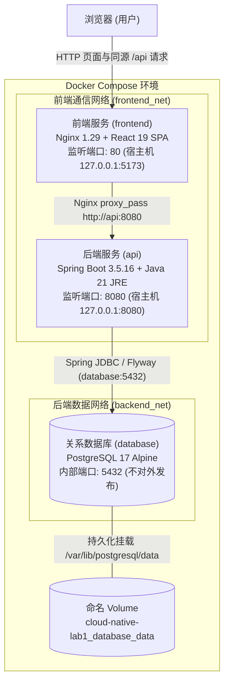
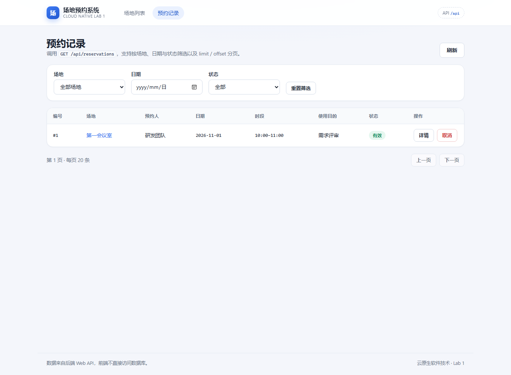
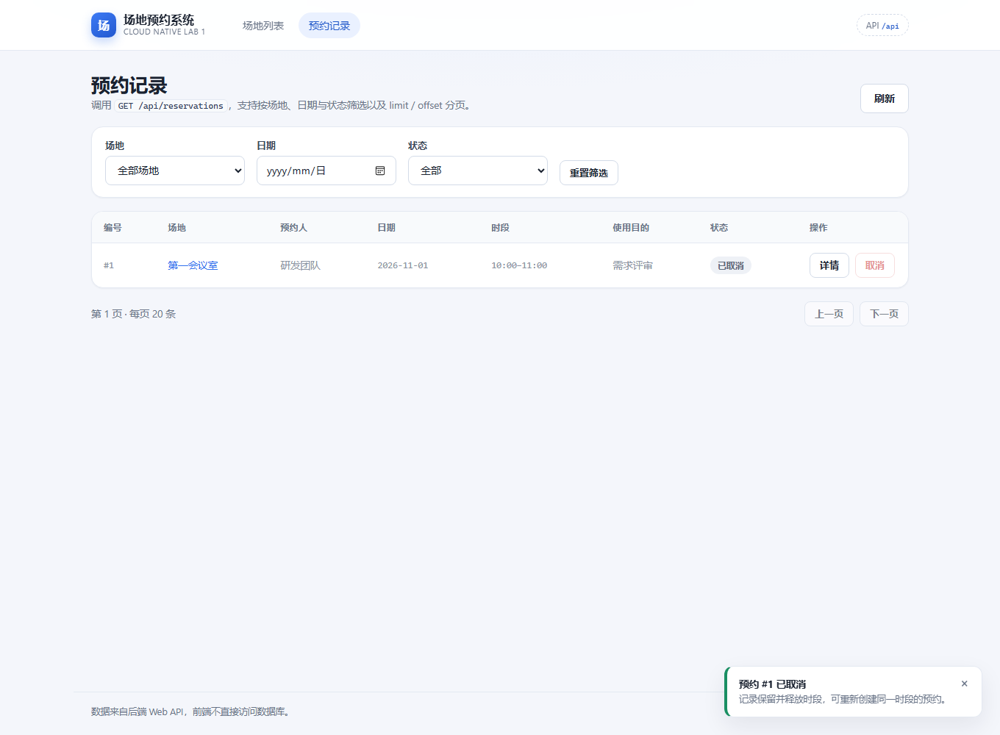
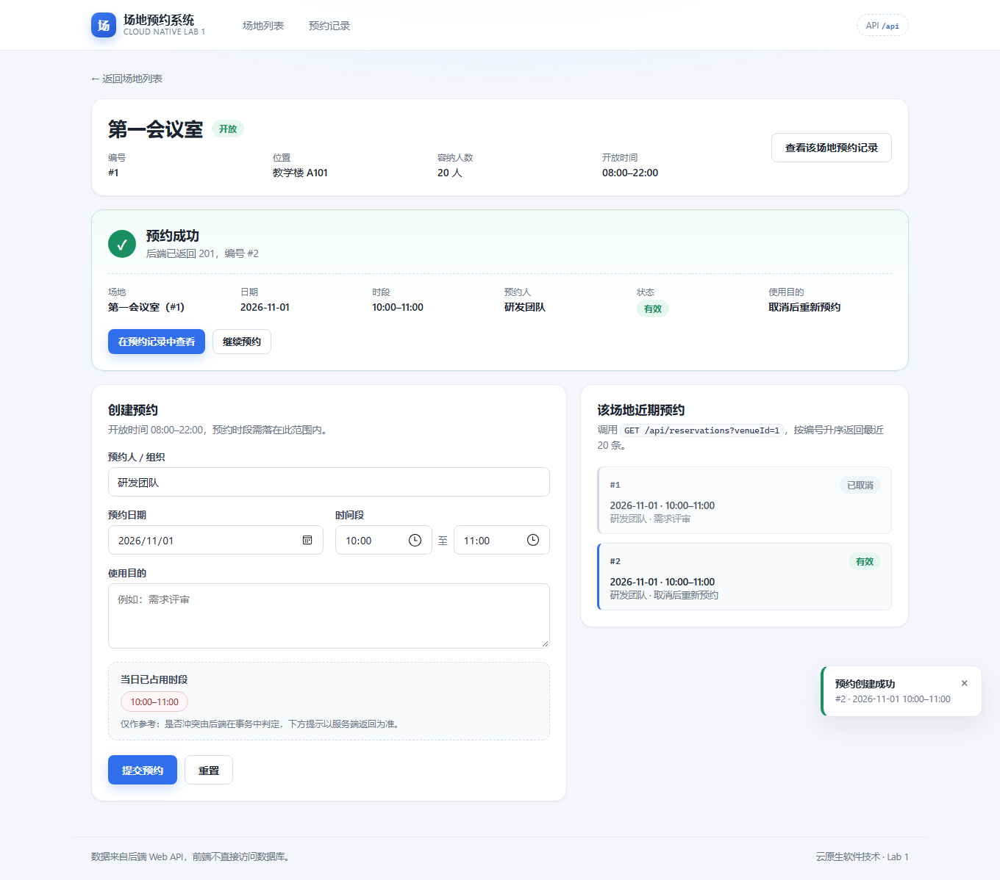
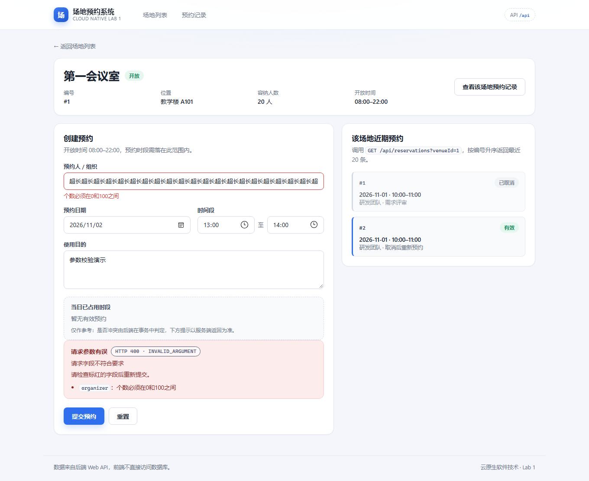
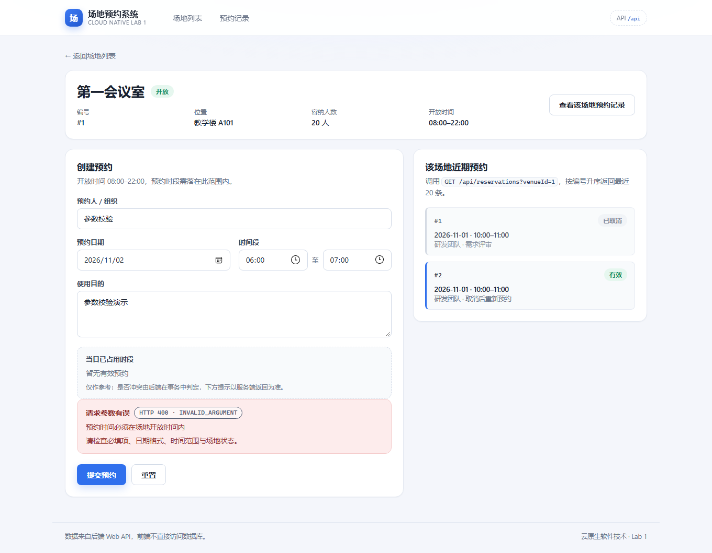

# 云原生软件技术 Lab 1 实验报告：场地预约系统开发与 Docker 容器化

---

## 一、系统架构、数据库结构与接口说明

### 1.1 系统总体架构与技术栈

本系统采用标准的三层架构（`frontend` → `api` → `database`）实现场地预约业务，并通过 Docker 容器化与 Docker Compose v2 完成多容器编排部署。



三个核心运行组件的职责与技术选型如下：

| 组件名称 | Compose 服务名 | 技术选型与运行环境 | 核心职责 |
|---|---|---|---|
| 前端（Frontend） | `frontend` | React 19 + TypeScript + Vite 8 + React Router 7；容器运行于 `nginx:1.29-alpine` | 提供场地列表、场地详情、新建场地、预约创建、预约记录筛选与取消等交互界面；通过 HTTP `/api` 调用后端接口，不直接连接数据库，也不作为预约冲突的唯一判定方 |
| 后端 API（Backend） | `api` | Java 21 + Spring Boot 3.5.16 + Spring JDBC + Flyway；容器运行于 `eclipse-temurin:21-jre-jammy` | 提供 RESTful JSON 接口；实现必填项校验、时间范围与场地开放状态检查；在数据库事务中通过行级锁（`SELECT ... FOR UPDATE`）拒绝同一场地同一时段的冲突预约 |
| 关系数据库（Database） | `database` | PostgreSQL 17（`postgres:17-alpine`） | 持久化存储场地表（`venues`）与预约表（`reservations`），通过命名 Volume 保障容器销毁重建后数据不丢失 |

---

### 1.2 数据库结构与迁移机制（成员 C & B 共同设计）

系统使用 **PostgreSQL 17** 作为关系数据库，并在后端启动时由 **Flyway** 自动执行位于 `backend/src/main/resources/db/migration/` 下的版本化 SQL 迁移脚本，保证表结构与初始演示数据的一致性和可重复性。

#### 1.2.1 实体关系与表结构定义（`V1__create_booking_tables.sql`）

数据库包含 `venues`（场地表）与 `reservations`（预约表）两张核心业务表，通过外键 `reservations.venue_id -> venues.id` 建立一对多关联关系：

```sql
CREATE TABLE venues (
    id BIGINT GENERATED ALWAYS AS IDENTITY PRIMARY KEY,
    name VARCHAR(100) NOT NULL CHECK (btrim(name) <> ''),
    location VARCHAR(255) NOT NULL CHECK (btrim(location) <> ''),
    capacity INTEGER NOT NULL CHECK (capacity > 0),
    opening_time TIME(0) NOT NULL,
    closing_time TIME(0) NOT NULL,
    status VARCHAR(16) NOT NULL CHECK (status IN ('OPEN', 'DISABLED')),
    CONSTRAINT valid_opening_hours CHECK (opening_time < closing_time)
);

CREATE TABLE reservations (
    id BIGINT GENERATED ALWAYS AS IDENTITY PRIMARY KEY,
    venue_id BIGINT NOT NULL REFERENCES venues(id),
    organizer VARCHAR(100) NOT NULL CHECK (btrim(organizer) <> ''),
    reservation_date DATE NOT NULL,
    start_time TIME(0) NOT NULL,
    end_time TIME(0) NOT NULL,
    purpose VARCHAR(500) NOT NULL CHECK (btrim(purpose) <> ''),
    status VARCHAR(16) NOT NULL CHECK (status IN ('ACTIVE', 'CANCELLED')),
    CONSTRAINT valid_reservation_times CHECK (start_time < end_time)
);

CREATE INDEX idx_reservation_active_slot
    ON reservations (venue_id, reservation_date, start_time, end_time)
    WHERE status = 'ACTIVE';
CREATE INDEX idx_reservation_date ON reservations (reservation_date, id);
```

- **`venues` 场地表字段映射与约束**：
  - `id`（`BIGINT`）：自增主键（场地编号）。
  - `name`（`VARCHAR(100)`）：场地名称，非空白字符串。
  - `location`（`VARCHAR(255)`）：所在位置，非空白字符串。
  - `capacity`（`INTEGER`）：可容纳人数，`CHECK (capacity > 0)`。
  - `opening_time` / `closing_time`（`TIME(0)`）：每日开放与关闭时间，表级约束 `CHECK (opening_time < closing_time)`。
  - `status`（`VARCHAR(16)`）：场地状态，仅允许 `OPEN`（开放）或 `DISABLED`（停用）。
- **`reservations` 预约表字段映射与约束**：
  - `id`（`BIGINT`）：自增主键（预约编号）。
  - `venue_id`（`BIGINT`）：外键引用 `venues(id)`，确保预约关联的场地真实存在。
  - `organizer`（`VARCHAR(100)`）：预约人或预约组织，非空白字符串。
  - `reservation_date`（`DATE`）：预约日期（`YYYY-MM-DD`）。
  - `start_time` / `end_time`（`TIME(0)`）：开始与结束时间，表级约束 `CHECK (start_time < end_time)`。
  - `purpose`（`VARCHAR(500)`）：使用目的，非空白字符串。
  - `status`（`VARCHAR(16)`）：预约状态，仅允许 `ACTIVE`（有效）或 `CANCELLED`（已取消）。
- **索引设计**：
  - `idx_reservation_active_slot`：针对 `status = 'ACTIVE'` 的部分索引（Partial Index），加速同场地、同日期有效预约的时间冲突检测查询。
  - `idx_reservation_date`：加速按预约日期与编号的筛选分页查询。

#### 1.2.2 种子数据初始化（`V2__seed_demo_venues.sql`）

首次启动容器时，Flyway 自动执行 `V2__seed_demo_venues.sql` 插入 3 条演示场地种子数据（2 个开放场地、1 个停用场地），已执行记录保存在 `flyway_schema_history` 表中，容器重启不会重复插入：

```sql
INSERT INTO venues (name, location, capacity, opening_time, closing_time, status)
VALUES ('第一会议室', '教学楼 A101', 20, '08:00', '22:00', 'OPEN'),
       ('篮球场', '体育中心东侧', 30, '09:00', '21:00', 'OPEN'),
       ('维护中的活动室', '学生活动中心 202', 15, '08:00', '18:00', 'DISABLED');
```

#### 1.2.3 取消预约策略说明（逻辑取消 vs 物理删除）

本系统的取消预约采用**逻辑取消（Logical Cancellation）**：
- 调用 `POST /api/reservations/{id}/cancel` 或 `DELETE /api/reservations/{id}` 时，后端不会执行 `DELETE FROM reservations` 物理删除，而是将记录的 `status` 字段更新为 `'CANCELLED'`。
- 冲突检测 SQL 仅扫描 `status = 'ACTIVE'` 的记录（`WHERE venue_id = :venueId AND reservation_date = :date AND status = 'ACTIVE' AND start_time < :end AND end_time > :start`）。
- 因此，取消预约后既能在预约列表中保留历史审计记录（状态显示为“已取消”），又能立即释放该时间段供后续预约重新使用。

---

### 1.3 后端 Web API 接口与业务逻辑说明

#### 1.3.1 接口列表

| HTTP 方法 | 接口路径 | 请求参数 / 请求体 | 成功状态码与响应 |
|---|---|---|---|
| `GET` | `/api/venues` | 查询参数：`limit`（默认 100，范围 1–200）、`offset`（默认 0） | `200 OK`，返回场地对象数组 |
| `GET` | `/api/venues/{id}` | 路径参数：`id`（正整数） | `200 OK`，返回单个场地对象 |
| `POST` | `/api/venues` | JSON：`name`, `location`, `capacity`, `openingTime`, `closingTime`, `status` | `201 Created`（含 `Location` 头），返回新建场地对象 |
| `POST` | `/api/reservations` | JSON：`venueId`, `organizer`, `reservationDate`, `startTime`, `endTime`, `purpose` | `201 Created`（含 `Location` 头），返回状态为 `ACTIVE` 的新建预约对象 |
| `GET` | `/api/reservations` | 查询参数：`venueId`、`date`、`status`、`order`（`ASC`/`DESC`）、`limit`、`offset` | `200 OK`，返回预约对象数组 |
| `GET` | `/api/reservations/{id}` | 路径参数：`id`（正整数） | `200 OK`，返回单条预约详情对象 |
| `POST` | `/api/reservations/{id}/cancel` | 路径参数：`id`（正整数），无请求体 | `200 OK`，返回状态更新为 `CANCELLED` 的预约对象 |
| `DELETE` | `/api/reservations/{id}` | 路径参数：`id`（正整数），无请求体 | `200 OK`，与 `/cancel` 逻辑完全一致 |

#### 1.3.2 预约冲突检测与并发控制流程

一次创建预约请求在 `READ COMMITTED` 事务中按以下步骤严格执行（见 `BookingService.java` 与 `BookingRepository.java`）：
1. **参数与时间校验**：校验必填字段非空，开始时间必须早于结束时间（`startTime < endTime`），拒绝秒以下精度。
2. **场地行级悲观锁**：对目标场地执行 `SELECT ... FROM venues WHERE id = ? FOR UPDATE`。若场地不存在立即返回 `404 NOT_FOUND`；若同一场地存在并发预约请求，后到达的事务将在此处串行等待行锁释放。
3. **场地状态与开放时间检查**：若场地状态为 `DISABLED`（停用），或预约时段 `[startTime, endTime)` 超出场地 `[openingTime, closingTime]` 范围，返回 `400 INVALID_ARGUMENT`。
4. **时段冲突检查**：按左闭右开区间 `[startTime, endTime)` 查询同场地、同日期下是否存在满足 `start_time < :endTime AND end_time > :startTime` 的 `ACTIVE` 预约（相邻时段如 `10:00–11:00` 与 `11:00–12:00` 允许共存）。若存在重叠，返回 `409 Conflict`（`error.code = "RESERVATION_CONFLICT"`）。
5. **写入与提交**：插入状态为 `ACTIVE` 的预约记录并提交事务，释放场地行锁，返回 `201 Created`。

#### 1.3.3 统一错误响应与异常屏蔽

`ApiErrorHandler` 拦截所有参数校验异常、业务异常和数据库异常，统一返回结构化 JSON，且 `application.yaml` 中显式配置了 `server.error.include-stacktrace: never`，确保绝不向普通用户暴露 Java 异常堆栈或 SQL 细节：

```json
{
  "error": {
    "code": "RESERVATION_CONFLICT",
    "message": "该场地在所选时间段已有有效预约",
    "details": []
  }
}
```

| 场景 | HTTP 状态码 | `error.code` |
|---|---|---|
| 查询或取消成功 | `200 OK` | - |
| 创建成功 | `201 Created` | - |
| 请求参数错误、无效时间范围、停用场地预约 | `400 Bad Request` | `INVALID_ARGUMENT` |
| 场地或预约不存在 | `404 Not Found` | `NOT_FOUND` |
| 预约时间段冲突 | `409 Conflict` | `RESERVATION_CONFLICT` |
| 数据库连接失败或锁等待超时 | `503 Service Unavailable` | `DATABASE_UNAVAILABLE` |
| 未处理的服务端错误 | `500 Internal Server Error` | `INTERNAL_ERROR` |

---

## 二、自定义服务的 Dockerfile 文件及说明

### 2.1 前端 Dockerfile 与 `.dockerignore`（`frontend/`）

#### `frontend/Dockerfile`

```dockerfile
# ---------- 构建阶段：只在这里安装依赖并编译，产物不进最终镜像 ----------
FROM node:24-alpine AS build
WORKDIR /app
ENV PNPM_HOME=/pnpm \
    PATH=/pnpm:$PATH \
    CI=true
# 固定 pnpm 版本，保证本地与容器构建一致；lockfile 保证依赖可复现。
RUN npm install -g pnpm@11.28.5 --no-fund --no-audit
COPY package.json pnpm-lock.yaml ./
RUN pnpm install --frozen-lockfile
COPY . .
RUN pnpm build

# ---------- 运行阶段：Nginx 提供静态文件并反向代理 /api ----------
FROM nginx:1.29-alpine AS runtime

# API_UPSTREAM 供 nginx 模板替换；API_BASE_URL 由启动脚本写入 config.js。
ENV API_UPSTREAM=api:8080 \
    API_BASE_URL=/api

COPY nginx/default.conf.template /etc/nginx/templates/default.conf.template
COPY docker/40-runtime-config.sh /docker-entrypoint.d/40-runtime-config.sh
RUN chmod +x /docker-entrypoint.d/40-runtime-config.sh

COPY --from=build /app/dist /usr/share/nginx/html

EXPOSE 80

HEALTHCHECK --interval=10s --timeout=3s --start-period=5s --retries=3 \
    CMD wget -q -O /dev/null http://127.0.0.1/healthz || exit 1

CMD ["nginx", "-g", "daemon off;"]
```

#### `frontend/.dockerignore`

```dockerignore
node_modules
dist
.git
.gitignore
.env
.env.*
!.env.example
*.log
docs
*.md
```

**设计说明**：
1. **多阶段构建**：第一阶段使用 `node:24-alpine` 和固定版本的 `pnpm@11.28.5`（`--frozen-lockfile`）编译产出静态文件 `dist/`；第二阶段使用轻量的 `nginx:1.29-alpine`，仅复制 `dist/` 产物与 Nginx 配置，最终运行镜像仅约 62 MB，不含 Node.js、源码与 `node_modules` 缓存。
2. **运行时外部化配置**：容器启动时通过 `/docker-entrypoint.d/40-runtime-config.sh` 将环境变量 `API_BASE_URL` 写入 `/usr/share/nginx/html/config.js`，并通过 `envsubst` 将 `API_UPSTREAM`（默认 `api:8080`）渲染进 Nginx 反向代理配置，更换后端地址无需重新构建镜像。
3. **前台主进程与端口声明**：声明 `EXPOSE 80`，以 `nginx -g "daemon off;"` 前台进程作为容器主进程，并提供 `/healthz` 端点供 `HEALTHCHECK` 检查。

---

### 2.2 后端 Dockerfile 与 `.dockerignore`（`backend/`）

#### `backend/Dockerfile`

```dockerfile
FROM maven:3.9.11-eclipse-temurin-21 AS build-base
WORKDIR /workspace
COPY pom.xml .
RUN mvn -B dependency:resolve
COPY src ./src

FROM build-base AS test
CMD ["mvn", "-B", "test"]

FROM build-base AS build
RUN mvn -B -DskipTests package

FROM eclipse-temurin:21-jre-jammy AS runtime
RUN apt-get update && apt-get install -y --no-install-recommends curl \
    && rm -rf /var/lib/apt/lists/* \
    && groupadd --gid 10001 app && useradd --uid 10001 --gid app --no-create-home app
WORKDIR /app
COPY --from=build --chown=app:app /workspace/target/venue-booking-api.jar /app/app.jar
USER app:app
EXPOSE 8080
HEALTHCHECK --interval=10s --timeout=3s --start-period=40s --retries=5 \
    CMD curl --fail --silent "http://localhost:${SERVER_PORT:-8080}/actuator/health" || exit 1
ENTRYPOINT ["java", "-jar", "/app/app.jar"]
```

#### `backend/.dockerignore`

```dockerignore
**
!pom.xml
!src/
!src/**
!Dockerfile
```

**设计说明**：
1. **白名单 `.dockerignore` 与缓存分层**：`.dockerignore` 采用白名单机制（先忽略 `**`，仅放行 `pom.xml`、`src/` 和 `Dockerfile`），彻底排除本地 `target/`、`.env`、IDE 配置与文档；Dockerfile 先复制 `pom.xml` 执行 `mvn dependency:resolve`，利用 Docker 层缓存加速后续源码变更构建。
2. **构建与运行分离**：运行阶段基于 `eclipse-temurin:21-jre-jammy`，仅包含打包后的 `app.jar`，不包含源码、Maven 编译工具与 `.m2` 缓存。
3. **非 root 用户与前台进程**：创建 UID/GID 为 `10001` 的低权限用户 `app:app` 并通过 `USER app:app` 运行，使用 `ENTRYPOINT ["java", "-jar", "/app/app.jar"]` 作为 PID 1 前台主进程，不写入任何数据库密码。

---

## 三、Compose 文件及说明（根目录 `compose.yaml`）

### 3.1 `compose.yaml` 完整内容

```yaml
name: cloud-native-lab1

services:
  database:
    image: postgres:17-alpine
    environment:
      POSTGRES_DB: ${DB_NAME:-venue_booking}
      POSTGRES_USER: ${DB_USERNAME:-venue_app}
      POSTGRES_PASSWORD: ${DB_PASSWORD:?Copy .env.example to .env and set DB_PASSWORD}
    volumes:
      - database_data:/var/lib/postgresql/data
    networks:
      - backend_net
    healthcheck:
      test: ["CMD-SHELL", "pg_isready -U \"$$POSTGRES_USER\" -d \"$$POSTGRES_DB\""]
      interval: 3s
      timeout: 3s
      retries: 20
    restart: unless-stopped

  api:
    image: cloud-native-lab1-api:1.0.0
    build:
      context: ./backend
      target: runtime
    environment:
      DB_URL: jdbc:postgresql://database:5432/${DB_NAME:-venue_booking}
      DB_USERNAME: ${DB_USERNAME:-venue_app}
      DB_PASSWORD: ${DB_PASSWORD:?Copy .env.example to .env and set DB_PASSWORD}
      CORS_ALLOWED_ORIGINS: ${CORS_ALLOWED_ORIGINS:-http://localhost:5173,http://127.0.0.1:5173,http://localhost:3000}
    ports:
      - "127.0.0.1:${API_PORT:-8080}:8080"
    networks:
      - frontend_net
      - backend_net
    depends_on:
      database:
        condition: service_healthy
    restart: unless-stopped

  frontend:
    image: cloud-native-lab1-frontend:1.0.0
    build:
      context: ./frontend
      target: runtime
    environment:
      API_BASE_URL: ${API_BASE_URL:-/api}
      API_UPSTREAM: api:8080
    ports:
      - "127.0.0.1:${FRONTEND_PORT:-5173}:80"
    networks:
      - frontend_net
    depends_on:
      api:
        condition: service_healthy
    restart: unless-stopped

networks:
  frontend_net:
  backend_net:

volumes:
  database_data:
```

### 3.2 根目录 `.env.example`

```dotenv
# Only demonstration values. Copy to .env for local deployment.
DB_NAME=venue_booking
DB_USERNAME=venue_app
DB_PASSWORD=lab1_demo_change_me

FRONTEND_PORT=5173
API_PORT=8080
CORS_ALLOWED_ORIGINS=http://localhost:5173,http://127.0.0.1:5173,http://localhost:3000
```

### 3.3 编排设计要点说明

1. **三服务依赖链与健康检查（Healthcheck）**：
   - `database` 使用 `pg_isready` 每 3 秒检测数据库就绪状态；
   - `api` 配置 `depends_on: database: { condition: service_healthy }`，确保 PostgreSQL 完全可接受连接后再启动 Spring Boot 与 Flyway 迁移；同時 `api` 自身通过 `/actuator/health` 探测 HTTP 与数据库连接状态；
   - `frontend` 配置 `depends_on: api: { condition: service_healthy }`，在后端 API 就绪后对外提供页面服务。
2. **双层网络隔离（`frontend_net` 与 `backend_net`）**：
   - `frontend` 仅加入 `frontend_net`，通过 Compose 服务名 `api:8080` 反向代理 `/api/` 请求；
   - `database` 仅加入 `backend_net`，`api` 同时加入两个网络并通过服务名 `database:5432` 访问数据库；
   - `frontend` 与 `database` 处于不同网络，从容器网络层保证了“前端不直接访问 `database`”。
3. **端口发布策略说明**：
   - `frontend` 发布 `127.0.0.1:5173:80` 供宿主机浏览器访问；
   - `api` 发布 `127.0.0.1:8080:8080` 用于本地开发联调与直接运行 `scripts/smoke.py` 冒烟验收脚本；
   - `database` **不对外发布任何宿主机端口**，仅在 `backend_net` 内部暴露 `5432/tcp`，符合实验指导书 7.2 节安全要求。
4. **配置外部化与密钥保护**：
   - 数据库密码 `DB_PASSWORD` 采用 `${DB_PASSWORD:?...}` 必填校验语法从 `.env` 读取，不在源码、`Dockerfile` 或 `compose.yaml` 中硬编码默认密码；真实 `.env` 已加入 `.gitignore`。

---

## 四、系统部署、启动、执行与持久化验证记录

### 4.1 容器构建与启动验证（对应指导书 8.2 节）

在项目根目录执行以下命令完成环境准备、镜像构建与多容器启动：

```bash
cp .env.example .env
docker compose up --build -d --wait
docker compose ps
```

**实际终端输出记录**：

```text
[+] up 8/8
 ✔ Image cloud-native-lab1-api:1.0.0      Built                           284.1s
 ✔ Image cloud-native-lab1-frontend:1.0.0 Built                            88.6s
 ✔ Network cloud-native-lab1_backend_net  Created                           0.0s
 ✔ Network cloud-native-lab1_frontend_net Created                           0.0s
 ✔ Volume cloud-native-lab1_database_data Created                           0.0s
 ✔ Container cloud-native-lab1-database-1 Healthy                          10.1s
 ✔ Container cloud-native-lab1-api-1      Healthy                          10.0s
 ✔ Container cloud-native-lab1-frontend-1 Healthy                          15.0s
NAME                           IMAGE                              COMMAND                  SERVICE    CREATED          STATUS                    PORTS
cloud-native-lab1-api-1        cloud-native-lab1-api:1.0.0        "java -jar /app/app.…"   api        15 seconds ago   Up 11 seconds (healthy)   127.0.0.1:8080->8080/tcp
cloud-native-lab1-database-1   postgres:17-alpine                 "docker-entrypoint.s…"   database   15 seconds ago   Up 15 seconds (healthy)   5432/tcp
cloud-native-lab1-frontend-1   cloud-native-lab1-frontend:1.0.0   "/docker-entrypoint.…"   frontend   15 seconds ago   Up 5 seconds (healthy)    127.0.0.1:5173->80/tcp
```

**服务连通性与健康检查验证**：

```bash
$ curl -s -o /dev/null -w "Frontend HTTP: %{http_code}\n" http://localhost:5173/
Frontend HTTP: 200

$ curl -s http://localhost:5173/healthz
ok

$ curl -s http://localhost:5173/config.js
window.__APP_CONFIG__ = { apiBaseUrl: "/api" };

$ curl -s http://localhost:8080/actuator/health
{"status":"UP"}

$ curl -s http://localhost:5173/api/venues
[{"id":1,"name":"第一会议室","location":"教学楼 A101","capacity":20,"openingTime":"08:00:00","closingTime":"22:00:00","status":"OPEN"},{"id":2,"name":"篮球场","location":"体育中心东侧","capacity":30,"openingTime":"09:00:00","closingTime":"21:00:00","status":"OPEN"},{"id":3,"name":"维护中的活动室","location":"学生活动中心 202","capacity":15,"openingTime":"08:00:00","closingTime":"18:00:00","status":"DISABLED"}]
```

---

### 4.2 数据持久化验证过程与结果（对应指导书 8.3 节）

按照实验指导书 8.3 节规定的 5 步流程进行数据持久化实测：

#### 步骤 1：创建一条预约并记录预约编号

通过前端 Nginx 代理接口 `POST http://localhost:5173/api/reservations` 创建一条预约：

```bash
$ curl -s -i -X POST http://localhost:5173/api/reservations \
  -H "Content-Type: application/json" \
  -d '{"venueId":1,"organizer":"C同学部署验收组","reservationDate":"2026-11-02","startTime":"14:00:00","endTime":"16:00:00","purpose":"Lab1数据持久化验证"}'
```

**响应输出（记录预约编号 `id: 1`）**：

```http
HTTP/1.1 201 
Server: nginx/1.29.8
Content-Type: application/json
Location: /api/reservations/1

{"id":1,"venueId":1,"organizer":"C同学部署验收组","reservationDate":"2026-11-02","startTime":"14:00:00","endTime":"16:00:00","purpose":"Lab1数据持久化验证","status":"ACTIVE"}
```

#### 步骤 2：执行 `docker compose down` 停止并移除所有容器与网络

```bash
$ docker compose down
[+] down 5/5
 ✔ Container cloud-native-lab1-frontend-1 Removed                           0.2s
 ✔ Container cloud-native-lab1-api-1      Removed                           0.3s
 ✔ Container cloud-native-lab1-database-1 Removed                           0.1s
 ✔ Network cloud-native-lab1_frontend_net Removed                           0.0s
 ✔ Network cloud-native-lab1_backend_net  Removed                           0.0s
```

#### 步骤 3：查看项目 Volume 并再次启动服务（`docker compose up -d`）

```bash
$ docker volume ls | grep cloud-native-lab1
local     cloud-native-lab1_database_data

$ docker compose up -d --wait
[+] up 5/5
 ✔ Network cloud-native-lab1_backend_net  Created                           0.0s
 ✔ Network cloud-native-lab1_frontend_net Created                           0.0s
 ✔ Container cloud-native-lab1-database-1 Healthy                          10.1s
 ✔ Container cloud-native-lab1-api-1      Healthy                          10.1s
 ✔ Container cloud-native-lab1-frontend-1 Healthy                          15.0s
```

检查重启后的 `database` 与 `api` 容器日志，确认 PostgreSQL 检测到已有数据目录（`PostgreSQL Database directory appears to contain a database; Skipping initialization`），且 Flyway 校验版本为 `2`（`Schema "public" is up to date. No migration necessary.`），未重复初始化。

#### 步骤 4：查询该预约（`id = 1`），确认数据仍然存在

```bash
$ curl -s http://localhost:5173/api/reservations/1
{"id":1,"venueId":1,"organizer":"C同学部署验收组","reservationDate":"2026-11-02","startTime":"14:00:00","endTime":"16:00:00","purpose":"Lab1数据持久化验证","status":"ACTIVE"}
```

**结论**：在所有容器被销毁并重新创建后，预约编号 `#1` 的全部字段与状态（`ACTIVE`）完整保留，证明命名 Volume `cloud-native-lab1_database_data` 数据持久化配置完全生效。

#### 步骤 5：运行自动化冒烟测试脚本验证核心业务链路

```bash
$ python3 backend/scripts/smoke.py --url http://localhost:8080
{"result": "PASS", "venueId": 4, "cancelledReservationId": 2, "persistentReservationId": 3}
```

---

## 五、主要的系统使用用例流程与记录（对应指导书 8.1 节）

前端界面通过 Nginx 容器对外提供访问（<http://localhost:5173>），完整覆盖实验指导书 8.1 节要求的 7 个基本功能验证步骤及参数错误提示：

### 5.1 步骤 1 & 2：打开前端页面、查询场地列表与详情

1. **打开前端页面查询场地列表（`/`）**：页面加载数据库中初始化的 3 个场地（`第一会议室`、`篮球场` 为开放状态，`维护中的活动室` 为停用状态），支持按关键词与状态筛选，顶部含“新建场地”折叠面板。
   
2. **查看场地基本信息与占用时段（`/venues/1`）**：点击“第一会议室”进入详情页，顶部展示场地位置、容纳人数、开放时间（`08:00 - 22:00`）与状态，下方提供创建预约表单及当日已占用时段展示。
   

### 5.2 步骤 3 & 4：创建正常预约并查询刚创建的预约

3. **创建正常预约**：填写预约人、预约日期、开始与结束时间及使用目的并提交，后端返回 `201 Created`，页面展示绿色“预约成功”卡片（含生成的预约编号 `#1`），并自动刷新当日占用时段与近期预约列表。
   
4. **查询刚创建的预约（`/reservations`）**：进入“预约记录”页面，支持按场地、日期、状态筛选，表格中显示刚创建的 `#1` 预约；点击“详情”按钮调用 `GET /api/reservations/1` 弹出完整预约详情对话框。
   
   

### 5.3 步骤 5：创建时间冲突的预约并确认后端拒绝

5. **提交时间冲突的预约**：在同一场地、同一日期再次提交与已有有效预约重叠的时间段，后端在事务中检测冲突并返回 `409 Conflict`（`RESERVATION_CONFLICT`），前端显示红色错误提示横幅“预约时间冲突：该场地在所选时间段已有有效预约”，并自动刷新当日已占用时段。
   

### 5.4 步骤 6 & 7：取消预约并在取消后的时间段重新创建预约

6. **取消预约**：在预约记录页点击 `#1` 的“取消”按钮并确认，前端调用 `POST /api/reservations/1/cancel`，状态变更为“已取消”（逻辑取消，记录保留在列表中，取消按钮变为禁用状态）。
   
7. **在取消后的时间段重新创建预约**：返回该场地详情页，对刚才已取消的同一时间段再次提交预约请求，后端返回 `201 Created`（生成新预约 `#2`），预约记录列表中同时保留 `#1 已取消` 与 `#2 有效`，验证了取消操作已正确释放时段。
   
   

### 5.5 补充验证：参数校验错误与超出开放时间提示

- **字段校验失败（400 `INVALID_ARGUMENT`）**：当输入超出长度限制或必填缺失时，后端返回字段级 `details`，前端将对应输入框标红并展示具体原因：
  
- **超出场地开放时间（400 `INVALID_ARGUMENT`）**：当提交 `06:00 - 07:00`（早于 `08:00` 开放时间）时，后端拒绝并返回明确错误提示：
  

---

## 六、小组分工与执行情况

本小组按“前端与交互 / 后端与业务 / 数据库与部署集成”三部分平行推进，每位成员同时负责各自模块的代码实现、容器配置、测试验证与报告章节撰写：

| 成员角色 | 主要职责 | 具体完成任务与交付物 | 执行情况 |
|---|---|---|---|
| **成员 A：前端与交互** | 完成用户操作页面与前端容器化 | 实现场地列表/详情、新建场地、预约创建、预约记录筛选与取消页面（`frontend/src/`）；展示成功、参数错误与 409 时间冲突提示；实现运行时 `API_BASE_URL` 配置注入与 Nginx `/api` 反向代理；编写 `frontend/Dockerfile` 与 `.dockerignore`；提供全流程页面截图与前端报告章节（`frontend/docs/`） | 100% 完成 |
| **成员 B：后端与业务** | 实现 Web API 与预约业务规则 | 基于 Spring Boot + Spring JDBC 实现全部场地与预约接口（`backend/src/main/`）；实现必填项、开放时间范围及场地状态校验；通过数据库事务与场地行级锁（`SELECT ... FOR UPDATE`）实现并发冲突拒绝；实现统一错误响应 `ApiErrorHandler`；编写 `backend/Dockerfile`、`.dockerignore`、29 项集成测试与后端报告章节 | 100% 完成 |
| **成员 C：数据库与部署集成** | 实现数据存储、三服务 Compose 编排与整体验收汇总 | 与 B 共同确定 `venues` / `reservations` 表结构、约束索引、Flyway 迁移脚本与演示种子数据；编写项目根目录 `compose.yaml`（配置三项服务、`frontend_net`/`backend_net` 双网络隔离、健康检查依赖链与命名 Volume 持久化）与 `.env.example`；编写根目录部署 `README.md`；执行三容器联调与数据持久化验证；撰写数据库与部署报告章节并汇总最终《Lab 1 实验报告》 | 100% 完成 |

---

## 七、问题与解决过程

1. **浏览器访问 `127.0.0.1:5173` 提交 POST 请求返回 HTTP 403**
   - **现象**：前端页面通过 `http://127.0.0.1:5173` 打开时，GET 场地列表正常显示，但 POST 创建预约或场地时返回 403 且无 JSON 响应体。
   - **原因**：虽然浏览器请求的是前端 Nginx 同源 `/api`，但浏览器在发送 POST 请求时仍会携带 `Origin: http://127.0.0.1:5173` 请求头并被 Nginx 转发给后端；后端 `CORS_ALLOWED_ORIGINS` 初始默认值仅包含 `http://localhost:5173`，Spring CORS 过滤器判定跨源不匹配而拒绝。
   - **解决**：在根目录 `.env.example` 与 `compose.yaml` 的 `CORS_ALLOWED_ORIGINS` 默认值中同时加入 `http://localhost:5173,http://127.0.0.1:5173,http://localhost:3000`，并在前端针对 403 状态码补充了明确的排查提示。
2. **并发创建同一场地同一时段预约时的竞态条件**
   - **现象**：在高并发场景下，若仅靠 `SELECT COUNT(*)` 检查有效预约再执行 `INSERT`，两个并发事务可能同时读到“无冲突”并各自插入成功，导致同一时段出现两条有效预约。
   - **原因**：默认的 `READ COMMITTED` 隔离级别下，普通查询不会阻塞另一个未提交事务对同一场地的插入。
   - **解决**：在 `BookingService` 创建与取消预约的事务开始时，先对目标场地执行 `SELECT ... FROM venues WHERE id = :venueId FOR UPDATE` 悲观行锁，强制同一场地的写入操作串行执行冲突检查与插入，并通过集成测试中的双线程并发预约测试验证通过（一个返回 `201`，另一个返回 `409`）。
3. **受限网络环境下 Docker 构建与基础镜像拉取超时**
   - **现象**：`Dockerfile` 首行若包含 `# syntax=docker/dockerfile:1`，BuildKit 会在构建前强行向 `registry-1.docker.io` 拉取 `docker/dockerfile:1` 前端解析器镜像，在校园网环境下直接超时失败；同时官方镜像拉取缓慢。
   - **解决**：移除 `Dockerfile` 中不必要的 `# syntax=docker/dockerfile:1` 指令（仅使用内置语法），并为 Docker Daemon 配置国内镜像加速源，使多阶段构建稳定快速完成。
4. **容器不重新构建镜像的前提下动态切换后端 API 地址**
   - **现象**：Vite 的 `import.meta.env.VITE_*` 变量在编译期即被静态替换进 JS 产物，若直接写死在构建阶段，修改后端地址必须重新执行 `docker build`。
   - **解决**：在前端镜像中设计 `/docker-entrypoint.d/40-runtime-config.sh` 启动脚本，每次容器启动时读取容器环境变量 `API_BASE_URL` 并动态生成 `/usr/share/nginx/html/config.js`（同时在 Nginx 中为 `/config.js` 配置 `Cache-Control: no-store`），实现仅靠环境变量和重启容器即可切换后端地址。
