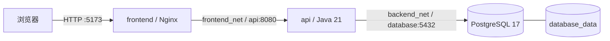

# Lab 1 实验报告：场地预约系统与 Docker 容器化

## 1. 系统架构与实现范围

系统提供场地浏览与创建、预约创建与查询、取消预约等功能。前端负责页面交互，后端处理业务校验和数据访问，PostgreSQL 保存场地与预约数据。全部服务通过根目录 Compose 部署。



| 模块 | 技术 | 责任 |
|---|---|---|
| 前端 | React 19、TypeScript、Vite 8、Nginx 1.29 | 页面、表单、HTTP 调用、状态和错误反馈 |
| 后端 | Java 21、Spring Boot 3.5.16、Spring JDBC、Flyway | 参数校验、开放时间检查、冲突控制、事务和数据库访问 |
| 数据库 | PostgreSQL 17 | 表结构、关联约束、索引、种子数据和持久化 |

浏览器只请求前端与 API，不连接数据库。根目录编排将前端与数据库放在不同网络中，API 同时加入两个网络。数据库不发布宿主机端口，API 的 8080 端口用于本地接口调试。

## 2. 数据库结构与业务规则

### 2.1 表结构

数据库与后端共同维护字段约定。表结构位于 [V1 迁移](../backend/src/main/resources/db/migration/V1__create_booking_tables.sql)，演示数据位于 [V2 迁移](../backend/src/main/resources/db/migration/V2__seed_demo_venues.sql)。

| 场地表 `venues` 列 | 类型 | 约束 |
|---|---|---|
| `id` | BIGINT IDENTITY | 主键 |
| `name` | VARCHAR(100) | 非空、非空白 |
| `location` | VARCHAR(255) | 非空、非空白 |
| `capacity` | INTEGER | 大于 0 |
| `opening_time` / `closing_time` | TIME(0) | 开放早于关闭 |
| `status` | VARCHAR(16) | OPEN / DISABLED |

| 预约表 `reservations` 列 | 类型 | 约束 |
|---|---|---|
| `id` | BIGINT IDENTITY | 主键 |
| `venue_id` | BIGINT | 外键引用 venues.id |
| `organizer` | VARCHAR(100) | 非空、非空白 |
| `reservation_date` | DATE | 非空 |
| `start_time` / `end_time` | TIME(0) | 起始早于结束 |
| `purpose` | VARCHAR(500) | 非空、非空白 |
| `status` | VARCHAR(16) | ACTIVE / CANCELLED |

`idx_reservation_active_slot` 是仅覆盖有效预约的部分索引，支持按场地、日期、时段检查冲突；`idx_reservation_date` 支持日期筛选。数据库列使用 snake_case，API 字段使用 camelCase，由 Repository 显式映射。

Flyway 在后端启动时按版本执行迁移，并在 `flyway_schema_history` 中保存结果。V2 创建“第一会议室”“篮球场”和“维护中的活动室”，其中两个开放、一个停用。已经执行的迁移不修改，新增结构使用后续版本。

### 2.2 预约与取消

创建预约在 READ COMMITTED 事务中执行：

1. 检查必填字段、时间格式和起止关系。
2. 对目标场地执行 `SELECT ... FOR UPDATE`，不存在返回 404。
3. 检查场地为 OPEN，且预约时段位于开放时间内，不满足返回 400。
4. 检查同场地、同日期的 ACTIVE 预约是否重叠，重叠返回 409。
5. 插入 ACTIVE 记录，提交事务后返回 201。

冲突条件为 `start_time < :end AND end_time > :start`。区间按 `[start, end)` 处理，因此 10:00-11:00 与 11:00-12:00 可以分别预约。

锁定场地行可以覆盖“该场地尚无预约”的情况，也能协调连接同一数据库的多个 API 实例。创建和取消使用相同的场地锁；同一场地不同日期的写入也会串行执行。锁等待上限为 5 秒。

取消采用逻辑取消，将状态更新为 CANCELLED，不删除历史记录。重复取消返回 200；冲突检查不再计入该记录，所以原时段可以重新预约。当前没有恢复或改期接口。

## 3. Web API 与字段约定

| 方法 | 接口 | 输入或查询 | 成功响应 |
|---|---|---|---|
| GET | `/api/venues` | limit、offset | 200，场地数组 |
| GET | `/api/venues/{id}` | 场地编号 | 200，场地对象 |
| POST | `/api/venues` | name、location、capacity、openingTime、closingTime、status | 201，场地对象和 Location |
| POST | `/api/reservations` | venueId、organizer、reservationDate、startTime、endTime、purpose | 201，预约对象和 Location |
| GET | `/api/reservations` | venueId、date、status、order、limit、offset | 200，预约数组 |
| GET | `/api/reservations/{id}` | 预约编号 | 200，预约对象 |
| POST | `/api/reservations/{id}/cancel` | 预约编号 | 200，CANCELLED 预约 |
| DELETE | `/api/reservations/{id}` | 预约编号 | 与显式取消相同 |

请求与响应使用 JSON，成功对象不包含额外的 data 包装。场地响应包含 `id` 和全部创建字段，预约响应额外包含 `id`、`status`。日期格式为 YYYY-MM-DD，时间支持 HH:mm 或 HH:mm:ss，响应统一包含秒。不支持跨天预约和秒以下精度。完整字段约束见 [后端 README](../backend/README.md)。

分页默认 100 条、最多 200 条，offset 从 0 开始。预约默认按编号升序；order=DESC 返回最近创建的记录，排序先于分页执行。

错误响应结构：

```json
{"error":{"code":"RESERVATION_CONFLICT","message":"该场地在所选时间段已有有效预约","details":[]}}
```

| 情况 | HTTP 状态 | error.code |
|---|---|---|
| 字段、时间或场地状态不符合要求 | 400 | INVALID_ARGUMENT |
| 资源不存在 | 404 | NOT_FOUND |
| 预约时段重叠 | 409 | RESERVATION_CONFLICT |
| 数据库不可用或锁等待超时等数据访问失败 | 503 | DATABASE_UNAVAILABLE |
| 未处理的服务端错误 | 500 | INTERNAL_ERROR |

`ApiErrorHandler` 统一处理错误，内部异常写入服务日志，响应不包含堆栈和 SQL。前端保留状态码与错误码供分支判断，页面显示操作提示和字段错误。

## 4. Dockerfile 与镜像

### 4.1 前端

[frontend/Dockerfile](../frontend/Dockerfile)：

```dockerfile
# 不写 # syntax=docker/dockerfile:1：该指令会让 BuildKit 从 Docker Hub 拉取 frontend 镜像，
# 在无法访问 registry-1.docker.io 的环境（如校园网、离线验收机）会直接构建失败。
# 本文件只用到内置 frontend 支持的语法，不需要额外镜像。

# ---------- 构建阶段：只在这里安装依赖并编译，产物不进最终镜像 ----------
FROM node:24-alpine AS build
WORKDIR /app
ENV PNPM_HOME=/pnpm \
    PATH=/pnpm:$PATH \
    CI=true
# 固定 pnpm 版本，保证本地与容器构建一致；lockfile 保证依赖可复现。
RUN npm install -g pnpm@11.28.5 --no-fund --no-audit
COPY package.json pnpm-lock.yaml ./
RUN pnpm install --frozen-lockfile
COPY . .
RUN pnpm build

# ---------- 运行阶段：Nginx 提供静态文件并反向代理 /api ----------
FROM nginx:1.29-alpine AS runtime

# API_UPSTREAM 供 nginx 模板替换；API_BASE_URL 由启动脚本写入 config.js。
ENV API_UPSTREAM=api:8080 \
    API_BASE_URL=/api

COPY nginx/default.conf.template /etc/nginx/templates/default.conf.template
COPY docker/40-runtime-config.sh /docker-entrypoint.d/40-runtime-config.sh
RUN chmod +x /docker-entrypoint.d/40-runtime-config.sh

COPY --from=build /app/dist /usr/share/nginx/html

EXPOSE 80

HEALTHCHECK --interval=10s --timeout=3s --start-period=5s --retries=3 \
    CMD wget -q -O /dev/null http://127.0.0.1/healthz || exit 1

# 使用官方入口脚本：依次执行 /docker-entrypoint.d/*.sh 后再以前台进程启动 Nginx。
CMD ["nginx", "-g", "daemon off;"]
```

构建阶段固定 pnpm 版本，使用 lockfile 安装依赖后执行类型检查和生产构建；运行阶段只复制 dist 和配置。`.dockerignore` 排除本地依赖、构建产物、环境文件和文档。Nginx 监听 80，前台运行，提供静态文件、API 代理及 SPA 路由回退。

启动脚本读取 API_BASE_URL 生成 config.js；Nginx 模板读取 API_UPSTREAM 设置代理目标。配置文件禁用缓存，静态哈希资源长期缓存。环境变量中的 URL 含未编码的引号、反斜杠或控制字符时，启动脚本报告配置错误。

### 4.2 后端

[backend/Dockerfile](../backend/Dockerfile)：

```dockerfile
FROM maven:3.9.11-eclipse-temurin-21 AS build-base
WORKDIR /workspace
COPY pom.xml .
RUN mvn -B dependency:resolve
COPY src ./src

FROM build-base AS test
CMD ["mvn", "-B", "test"]

FROM build-base AS build
RUN mvn -B -DskipTests package

FROM eclipse-temurin:21-jre-jammy AS runtime
RUN apt-get update && apt-get install -y --no-install-recommends curl \
    && rm -rf /var/lib/apt/lists/* \
    && groupadd --gid 10001 app && useradd --uid 10001 --gid app --no-create-home app
WORKDIR /app
COPY --from=build --chown=app:app /workspace/target/venue-booking-api.jar /app/app.jar
USER app:app
EXPOSE 8080
HEALTHCHECK --interval=10s --timeout=3s --start-period=40s --retries=5 \
    CMD curl --fail --silent "http://localhost:${SERVER_PORT:-8080}/actuator/health" || exit 1
ENTRYPOINT ["java", "-jar", "/app/app.jar"]
```

后端先复制 pom.xml 解析依赖，再复制源码，利用分层缓存减少重复下载。运行阶段只保留 JRE、可执行 JAR 和健康检查所需 curl，不包含 Maven、源码和依赖缓存。容器使用 UID 10001 的 app 用户，Java 作为 PID 1 运行。

后端 `.dockerignore` 使用白名单，只放行 pom.xml、src/ 和 Dockerfile。数据库密码不写入镜像，通过运行环境传入。

## 5. Compose 与配置

根目录 [compose.yaml](../compose.yaml)：

```yaml
name: cloud-native-lab1

services:
  database:
    image: postgres:17-alpine
    environment:
      POSTGRES_DB: ${DB_NAME:-venue_booking}
      POSTGRES_USER: ${DB_USERNAME:-venue_app}
      POSTGRES_PASSWORD: ${DB_PASSWORD:?Copy .env.example to .env and set DB_PASSWORD}
    volumes:
      - database_data:/var/lib/postgresql/data
    networks:
      - backend_net
    healthcheck:
      test: ["CMD-SHELL", "pg_isready -U \"$$POSTGRES_USER\" -d \"$$POSTGRES_DB\""]
      interval: 3s
      timeout: 3s
      retries: 20
    restart: unless-stopped

  api:
    image: cloud-native-lab1-api:1.0.0
    build:
      context: ./backend
      target: runtime
    environment:
      DB_URL: jdbc:postgresql://database:5432/${DB_NAME:-venue_booking}
      DB_USERNAME: ${DB_USERNAME:-venue_app}
      DB_PASSWORD: ${DB_PASSWORD:?Copy .env.example to .env and set DB_PASSWORD}
      CORS_ALLOWED_ORIGINS: ${CORS_ALLOWED_ORIGINS:-http://localhost:5173,http://127.0.0.1:5173,http://localhost:3000}
    ports:
      - "127.0.0.1:${API_PORT:-8080}:8080"
    networks:
      - frontend_net
      - backend_net
    depends_on:
      database:
        condition: service_healthy
    restart: unless-stopped

  frontend:
    image: cloud-native-lab1-frontend:1.0.0
    build:
      context: ./frontend
      target: runtime
    environment:
      API_BASE_URL: ${API_BASE_URL:-/api}
      API_UPSTREAM: api:8080
    ports:
      - "127.0.0.1:${FRONTEND_PORT:-5173}:80"
    networks:
      - frontend_net
    depends_on:
      api:
        condition: service_healthy
    restart: unless-stopped

networks:
  frontend_net:
  backend_net:

volumes:
  database_data:
```

数据库使用 pg_isready 检查可用状态，API 等待数据库健康后启动，前端等待 API 健康后启动。API 的健康检查同时检查数据库连通性。

| 配置 | 注入位置 |
|---|---|
| DB_NAME、DB_USERNAME、DB_PASSWORD | 数据库和 API |
| CORS_ALLOWED_ORIGINS | API |
| API_BASE_URL、API_UPSTREAM | 前端 |
| FRONTEND_PORT、API_PORT | Compose 宿主机端口映射 |

[.env.example](../.env.example) 提供演示值，真实 .env 已忽略。根目录默认支持 localhost:5173、127.0.0.1:5173 和 localhost:3000 对应的 HTTP origin；更换浏览器访问地址后应同步配置白名单。修改 .env 后用 `docker compose up -d` 重新创建受影响容器，单独 restart 不会加载新的 Compose 环境变量。

数据库命名卷为 cloud-native-lab1_database_data，挂载至 /var/lib/postgresql/data。后端独立开发编排使用不同项目名和数据卷，不能与完整部署的数据混用。

## 6. 部署、功能流程与持久化

### 6.1 启动

在根目录首次复制配置，再构建启动：

```sh
cp .env.example .env
docker compose up --build -d --wait
docker compose ps
```

三个服务均已运行并通过健康检查。页面入口为 http://localhost:5173，前端 `/healthz` 返回 ok，后端 `/actuator/health` 返回 UP。Nginx 的 `/api/venues` 请求能返回数据库中的场地。

### 6.2 主要使用流程

场地列表展示位置、容量、开放时间和状态，支持搜索、筛选与新建场地。


进入场地详情，填写预约人、日期、时段和目的。停用场地不允许提交；必填项和起止时间在表单中检查，后端再次校验。


提交成功后显示编号、场地、时段、预约人和状态，并更新占用时段及近期记录。


相同时段重复提交时，后端返回 409，前端提示调整时段或先取消原预约。开放时间以外的请求返回 400。


预约记录支持按场地、日期和状态筛选，点击详情可查看完整字段。取消前弹出确认框；取消后保留记录并标为已取消。相同时段重新预约会生成新编号。


### 6.3 数据保留与自动化测试

按以下流程移除并重建容器，整个过程不附加 -v：

```sh
# 先创建预约，保存返回对象和编号
docker compose down
docker compose up -d --wait
# 再查询同一预约，比较字段和状态
curl -fsS http://localhost:5173/api/reservations/4
docker volume ls --filter name=cloud-native-lab1
```

该次运行中，重建前后的 5 个场地和 4 条预约逐字段一致，预约 #4 保持 ACTIVE；PostgreSQL 使用已有数据目录，Flyway 检查 V2 无需再次迁移。编号 4 是该次运行的示例，重新操作时以实际响应编号为准。

后端 29 项测试覆盖参数、状态、时间边界、各种重叠、取消重约、分页和并发冲突。前端 19 项测试覆盖完整场地加载、筛选、分页边界、异步请求先后、路由状态和错误反馈；生产构建同时执行 TypeScript 检查。HTTP 冒烟脚本完成创建场地、预约、拒绝冲突、取消和重新预约流程。

## 7. 分工与交付

| 模块 | 负责内容 | 交付位置 |
|---|---|---|
| 前端 | 页面、接口调用、交互反馈、响应式布局、前端镜像和说明 | frontend/ |
| 后端 | API、参数校验、预约业务、并发事务、错误处理、后端镜像和测试 | backend/ |
| 数据库 | 与后端确定表结构、约束和迁移；集成三服务编排、网络、数据卷与项目部署文档 | backend/src/main/resources/db/migration/、compose.yaml、.env.example、README.md |

## 8. 问题处理与当前边界

- 并发预约通过场地行锁协调，避免两个请求同时通过冲突检查。数据库尚未使用排斥约束，直接 SQL 写入可绕过业务规则，业务写操作应通过 API。
- 同源代理下的 POST 仍携带 Origin。若出现列表可读但提交 403，应检查白名单，页面不展示内部配置细节。
- 切换场地会清除旧页面状态；切换日期后忽略过时请求。时段和近期记录查询失败会显示错误和重试，不能将失败当作“没有预约”。
- 预约分页多取一条判断后续页，避免恰好满页时进入空页；URL 中的场地筛选与页面保持同步。
- 基础镜像下载受网络环境影响。遇到认证或下载超时，可确认网络后重试拉取，再重新构建。
- 系统没有登录、权限、改期和后台任务。前端时段参考最多读取 200 条记录；大量场地场景应增加服务端搜索和总数统计。当前日期按场地当地时间使用，未实现多时区场地。
