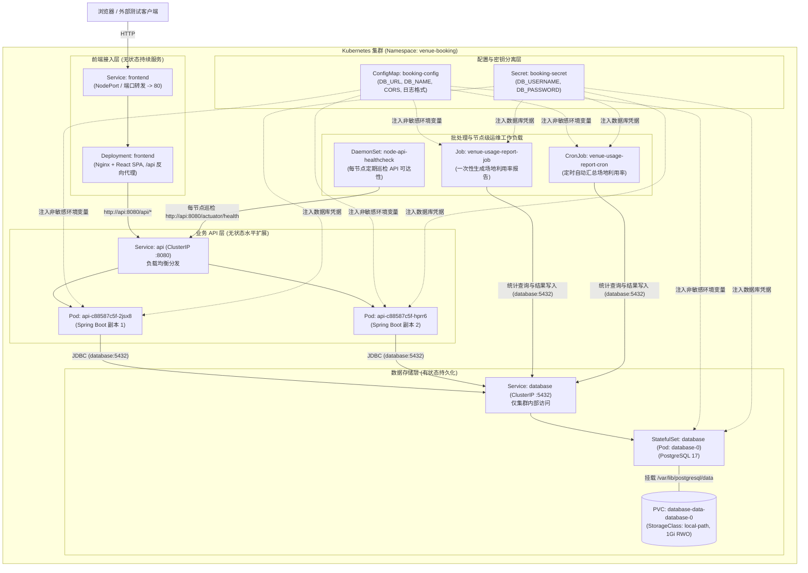
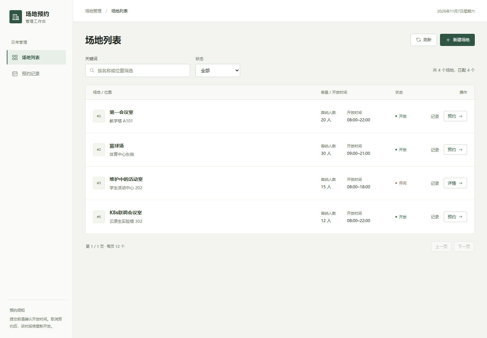
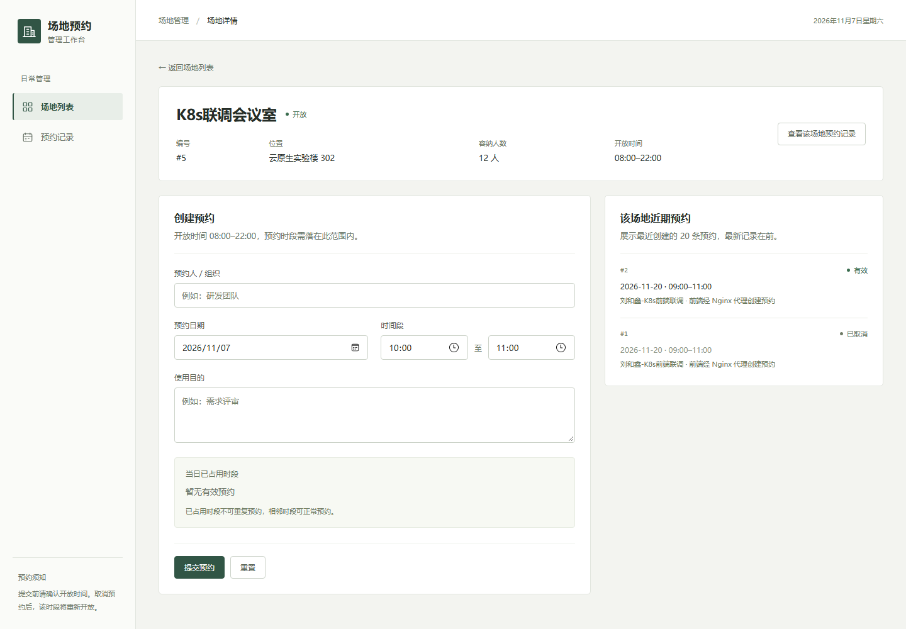
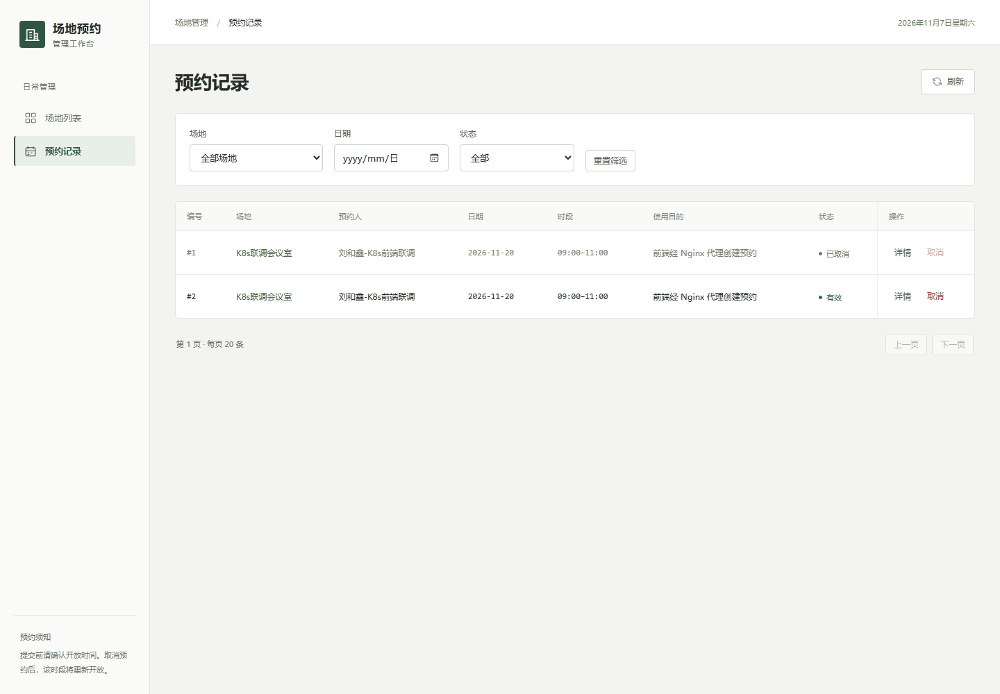

# 云原生软件技术 Lab 2：场地预约系统 Kubernetes 工作负载编排实验报告

---

## 1. 实验环境介绍

本实验在保留 Lab 1 容器化成果的基础上，使用本地 Kubernetes 集群完成系统的迁移与多工作负载编排。

### 1.1 集群环境基本信息

| 环境属性 | 实际配置信息 |
|---|---|
| **Kubernetes 运行环境** | Colima 内置 K3s 集群（基于 macOS Virtualization.Framework，Ubuntu 24.04.4 LTS 虚拟机） |
| **Kubernetes 版本** | Server: `v1.35.0+k3s1` / Client (`kubectl`): `v1.37.2` |
| **节点数量与角色** | 1 个节点（`colima`，角色：`control-plane` 兼工作节点，架构：`aarch64`） |
| **容器运行时** | Docker Engine `docker://29.5.2` |
| **默认 StorageClass** | `local-path`（Provisioner: `rancher.io/local-path`，绑定模式：`WaitForFirstConsumer`） |
| **镜像使用方式** | Colima Kubernetes 与宿主机 Docker 共享同一容器守护进程与本地镜像存储；本地通过 `docker build` 构建的镜像（如 `cloud-native-lab1-api:1.0.0`）配合 `imagePullPolicy: IfNotPresent` 直接被 Kubelet 拉起，无需导出 tar 包或推送至远程镜像仓库 |

> 前端与 DaemonSet 模块另在本地 Docker Desktop Kubernetes `v1.36.1`（kind 模式，单节点）完成回归；该模式使用独立的 containerd 镜像存储且不把 NodePort 映射到宿主机，因此回归时通过 `docker save` + `ctr -n k8s.io images import` 导入镜像，并用 `kubectl port-forward` 访问前端。两种环境使用同一套资源清单，详见 §3.3。

### 1.2 集群节点、StorageClass 与命名空间资源证据

执行 `kubectl version`、`kubectl get nodes -o wide`、`kubectl get storageclass` 及 `kubectl get all,pvc,cm,secret -n venue-booking` 的实际输出如下：

```text
$ kubectl version
Client Version: v1.37.2
Kustomize Version: v5.8.1
Server Version: v1.35.0+k3s1

$ kubectl get nodes -o wide
NAME     STATUS   ROLES           AGE     VERSION        INTERNAL-IP   EXTERNAL-IP   OS-IMAGE             KERNEL-VERSION      CONTAINER-RUNTIME
colima   Ready    control-plane   6m16s   v1.35.0+k3s1   192.168.5.1   <none>        Ubuntu 24.04.4 LTS   6.8.0-117-generic   docker://29.5.2

$ kubectl get storageclass
NAME                   PROVISIONER             RECLAIMPOLICY   VOLUMEBINDINGMODE      ALLOWVOLUMEEXPANSION   AGE
local-path (default)   rancher.io/local-path   Delete          WaitForFirstConsumer   false                  6m15s

$ kubectl get statefulset,deployment,pod,svc,pvc,cm,secret -n venue-booking -o wide
NAME                        READY   AGE     CONTAINERS   IMAGES
statefulset.apps/database   1/1     5m18s   postgres     postgres:17-alpine

NAME                  READY   UP-TO-DATE   AVAILABLE   AGE    CONTAINERS   IMAGES                        SELECTOR
deployment.apps/api   2/2     2            2           5m7s   api          cloud-native-lab1-api:1.0.0   app=api

NAME                      READY   STATUS    RESTARTS   AGE   IP           NODE     NOMINATED NODE   READINESS GATES
pod/database-0            1/1     Running   0          8s    10.42.0.18   colima   <none>           <none>
pod/api-c88587c5f-2jsx8   1/1     Running   0          54s   10.42.0.16   colima   <none>           <none>
pod/api-c88587c5f-hprr6   1/1     Running   0          68s   10.42.0.15   colima   <none>           <none>

NAME               TYPE        CLUSTER-IP      EXTERNAL-IP   PORT(S)    AGE     SELECTOR
service/database   ClusterIP   10.43.215.138   <none>        5432/TCP   5m18s   app=database
service/api        ClusterIP   10.43.30.73     <none>        8080/TCP   5m7s    app=api

NAME                                             STATUS   VOLUME                                     CAPACITY   ACCESS MODES   STORAGECLASS   AGE
persistentvolumeclaim/database-data-database-0   Bound    pvc-a08a482c-dfc1-47ab-81a2-2e06a67236b1   1Gi        RWO            local-path     5m29s

NAME                       DATA   AGE
configmap/booking-config   7      5m30s

NAME                    TYPE     DATA   AGE
secret/booking-secret   Opaque   2      5m30s
```

---

## 2. Lab 2 系统架构与组件设计

### 2.1 系统架构图

系统所有组件统一部署在 `venue-booking` 命名空间下，结合各组件的无状态/有状态特征、持续服务/批处理/节点级特征，分别采用 `Deployment`、`StatefulSet`、`Job`、`CronJob` 和 `DaemonSet` 编排：



### 2.2 Kubernetes 资源清单与选型说明表

| 资源类型 | 本组资源名称 | 承载的组件或任务 | 用途与选择理由说明 |
|---|---|---|---|
| **Deployment** | `api`<br/>`frontend` | 后端 Web API 服务（2 副本）<br/>前端 Nginx + SPA 服务 | 后端 API 与前端均为**无状态持续运行服务**，本地不保存任何会话或业务状态；使用 `Deployment` 支持声明式滚动更新、故障自愈与多副本水平扩展 |
| **StatefulSet** | `database` | PostgreSQL 17 关系数据库（1 副本：`database-0`） | 数据库是典型的**有状态组件**，需要稳定的网络标识（`database-0`）、有序的部署/重建生命周期以及通过 `volumeClaimTemplates` 专属绑定的持久化存储卷 |
| **Job** | *(待徐润杰补充：如 `venue-report-job`)* | 一次性场地利用率统计报告生成 | 报告统计属于**一次性批处理任务**，读取指定日期范围的有效预约、计算次数与累计时长并写入数据库后即正常退出（`Completed`），无需常驻运行 |
| **CronJob** | *(待徐润杰补充：如 `venue-report-cron`)* | 定时场地利用率统计报告任务 | 周期性按计划（如每分钟演示 / 生产环境每日凌晨）自动创建 `Job` 执行统计逻辑 |
| **DaemonSet** | `node-api-healthcheck` | 节点级 API 健康巡检任务 | 满足**集群中每个符合条件的节点都必须运行一个副本**的运维观测场景，在各节点本地每 30 秒探测 `api` 服务可达性，并输出带节点名（`spec.nodeName`）、Pod 名与 UP/DOWN 状态的巡检日志 |
| **Service** | `database` (`ClusterIP`)<br/>`api` (`ClusterIP`)<br/>`frontend` (`NodePort`) | 数据库内部发现入口（`:5432`）<br/>API 内部负载均衡入口（`:8080`）<br/>前端浏览器访问入口（`:30080`） | 屏蔽 Pod 重建导致的临时 IP 变化，提供稳定的 DNS 名称（`database`、`api`）；`database` 和 `api` 仅用 `ClusterIP` 限制在集群内部通信，前端通过 NodePort 30080 对外提供浏览器入口 |
| **ConfigMap** | `booking-config` | 数据库地址/库名、服务端口、CORS 白名单、Spring Web 日志格式 | 将非敏感运行配置从容器镜像中解耦，支持修改配置后滚动重启生效，无需重新构建镜像 |
| **Secret** | `booking-secret` | 数据库用户名（`DB_USERNAME`）与密码（`DB_PASSWORD`） | 独立存储敏感凭据，避免密码出现在代码、镜像或普通 `ConfigMap` 中；真实 `02-secret.yaml` 加入 `.gitignore`，仓库仅保留 `.example.yaml` 模板 |
| **PVC** | `database-data-database-0` | PostgreSQL 数据目录（`/var/lib/postgresql/data`）持久化 | 由 `StatefulSet` 的 `volumeClaimTemplates` 自动通过 `local-path` StorageClass 动态创建（`1Gi`, `ReadWriteOnce`），保证 `database-0` Pod 删除重建后场地与预约数据不丢失 |

### 2.3 核心架构设计重点说明

1. **为什么不同组件分别选择 `Deployment`、`StatefulSet`、`Job`、`CronJob` 和 `DaemonSet`？**
   - **`api` 与 `frontend` 选择 `Deployment`**：二者均为无状态（Stateless）HTTP 服务。`api` 的所有业务数据均存储在后端 PostgreSQL 中，并发预约冲突通过数据库事务与行级锁（`SELECT ... FOR UPDATE`）协调，任意一个 `api` Pod 实例都是完全对等、可随时替换的，因此最适合使用 `Deployment` 进行多副本水平扩展。
   - **`database` 选择 `StatefulSet`**：关系数据库是有状态（Stateful）服务，数据文件存储在底层文件系统中，要求 Pod 在销毁重建后仍然保有相同的标识（`database-0`）并自动重新挂载同一个专属 PVC（`database-data-database-0`），避免出现多个实例争抢同一块读写磁盘目录或挂载错卷的问题。
   - **场地利用率报告选择 `Job` 与 `CronJob`**：报告计算是“输入日期范围 $\rightarrow$ 聚合计算 $\rightarrow$ 保存结果 $\rightarrow$ 结束退出”的批处理过程，不需要监听端口或常驻内存，因此单次触发使用 `Job`，周期性自动触发使用 `CronJob`。
   - **节点巡检选择 `DaemonSet`**：节点网络连通性与 API 可达性巡检与具体物理/虚拟节点绑定，需要保证集群中每个节点恰好运行一个巡检 Pod（随节点扩容自动部署），因此选择 `DaemonSet`。

2. **为什么需要或不需要 `Service`？各 `Service` 类型如何选择？**
   - **需要 `Service` 的组件**：
     - `database`：需要被 `api`、`Job`、`CronJob` 访问。由于 Pod 重建后 IP 会改变（如本次实测中 `database-0` 重建前 IP 为 `10.42.0.13`，重建后变为 `10.42.0.18`），必须通过 `ClusterIP` 类型的 `Service`（DNS 名称 `database:5432`）提供稳定访问入口，且**绝不暴露到集群外**，保障数据安全。
     - `api`：需要被 `frontend`（Nginx 反向代理）和巡检 `DaemonSet` 访问，且后端有 2 个 Pod 副本，因此通过 `ClusterIP` 类型的 `Service`（`api:8080`）提供稳定的集群内 DNS 名称与流量负载均衡。
     - `frontend`：需要被集群外的用户浏览器访问，因此需要配置对外暴露的 `Service`（如 `NodePort` 或端口转发）。
   - **不需要 `Service` 的组件**：
     - `Job`、`CronJob` 和 `DaemonSet` 均为主动发起请求或执行任务的组件，没有其他服务需要向它们发起入站网络连接，因此**不需要暴露任何 `Service`**。

3. **副本数选择依据：为什么 `api` 设置 2 个副本，而 `database` 设置 1 个副本？**
   - **`api` 设置 2 个副本（`replicas: 2`）**：
     - **无状态与并发安全**：`api` 进程自身不保存状态；在创建预约时，通过 PostgreSQL 的 `SELECT ... FROM venues WHERE id = :venueId FOR UPDATE` 行级悲观锁在数据库层串行化同一场地的并发写入，因此多个 `api` 副本同时工作不会破坏预约冲突校验的一致性。
     - **高可用与负载分担**：2 个副本配合 `readinessProbe`（`/actuator/health`）可在单个 Pod 故障或滚动更新期间保证服务不中断，并由 `api` Service 将查询与预约请求分摊到两个实例上处理。
   - **`database` 保持 1 个副本（`replicas: 1`）**：
     - 标准 `postgres:17-alpine` 镜像是单主架构（Single-Primary），不支持多个容器实例直接读写挂载同一个文件系统目录，也不具备开箱即用的多主同步复制能力。若盲目将 `StatefulSet` 设为多副本，新副本会拥有独立空白 PVC、数据彼此割裂，导致 API 读到不一致的数据。因此在不引入主从复制中间件的前提下，数据库保持单副本有状态运行是最合理的设计。

4. **`ConfigMap` 与 `Secret` 的内容边界与引用方式**
   - **内容边界**：
     - `ConfigMap`（[`k8s/01-configmap.yaml`](../k8s/01-configmap.yaml)）仅存放**非敏感配置**：`DB_NAME`、`DB_HOST`、`DB_PORT`、`DB_URL`、`SERVER_PORT`、`CORS_ALLOWED_ORIGINS` 以及用于可观测性的 `LOGGING_LEVEL_WEB` 和 `LOGGING_PATTERN_CONSOLE`。
     - `Secret`（模板见 [`k8s/02-secret.example.yaml`](../k8s/02-secret.example.yaml)）专门存放**敏感凭据**：`DB_USERNAME` 与 `DB_PASSWORD`。真实的 `k8s/02-secret.yaml` 被列入 `.gitignore`，不进入版本控制。
   - **引用方式**：
     - `database` Pod 使用 `valueFrom.configMapKeyRef` 和 `valueFrom.secretKeyRef` 将配置精确映射为官方镜像要求的 `POSTGRES_DB`、`POSTGRES_USER`、`POSTGRES_PASSWORD` 环境变量；
     - `api` Pod 使用 `envFrom` 批量注入 `booking-config` 与 `booking-secret` 中的全部键值。

5. **PVC 与存储方案如何满足数据持久化需求**
   - `database` `StatefulSet` 配置了 `volumeClaimTemplates`，向集群默认 `StorageClass`（`local-path`）申请 `1Gi`、`ReadWriteOnce` 的持久化卷 `database-data-database-0`，挂载至容器内 `/var/lib/postgresql/data`，并显式指定 `PGDATA=/var/lib/postgresql/data/pgdata`。
   - 当 `database-0` Pod 因故障或手动删除被销毁时，PVC 与底层 PV 不会被删除；`StatefulSet` 控制器自动新建的 `database-0` Pod 会根据名称后缀 `-0` 重新绑定同一个 `database-data-database-0` PVC，PostgreSQL 直接加载已有数据目录，Flyway 检测到历史版本为 `V2` 跳过重复初始化，从而完整保留所有场地和预约数据。

---

## 3. 系统使用报告与工作负载验证结果

### 3.1 数据库 `StatefulSet` + `PVC` Pod 重建持久化验证（施钧凯）

通过自动化验收脚本 [`k8s/scripts/verify-db-and-api.sh`](../k8s/scripts/verify-db-and-api.sh) 执行完整的“写入预约 $\rightarrow$ 删除 `database-0` Pod $\rightarrow$ 等待重建就绪 $\rightarrow$ 重新查询验证”流程：

```text
=== 5. 验证数据库 Pod 重建后的数据持久化 (StatefulSet + PVC) ===
[5.1] 创建一条测试场地与预约记录...
创建响应: {"id":3,"venueId":5,"organizer":"施钧凯-K8s验收","reservationDate":"2026-11-15","startTime":"09:00:00","endTime":"11:00:00","purpose":"StatefulSet+PVC重建持久化验证","status":"ACTIVE"}
记录场地编号: venueId=5, 预约编号: id=3

[5.2] 删除数据库 Pod (database-0) 触发 StatefulSet 自动重建...
pod "database-0" deleted from venue-booking namespace
Waiting for 1 pods to be ready...
partitioned roll out complete: 1 new pods have been updated...
NAME         READY   STATUS    RESTARTS   AGE   IP           NODE     NOMINATED NODE   READINESS GATES
database-0   1/1     Running   0          8s    10.42.0.18   colima   <none>           <none>
NAME                       STATUS   VOLUME                                     CAPACITY   ACCESS MODES   STORAGECLASS   VOLUMEATTRIBUTESCLASS   AGE
database-data-database-0   Bound    pvc-a08a482c-dfc1-47ab-81a2-2e06a67236b1   1Gi        RWO            local-path     <unset>                 5m29s

[5.3] 重新查询预约 id=3，验证数据持久化...
重建后查询响应: {"id":3,"venueId":5,"organizer":"施钧凯-K8s验收","reservationDate":"2026-11-15","startTime":"09:00:00","endTime":"11:00:00","purpose":"StatefulSet+PVC重建持久化验证","status":"ACTIVE"}
```

**验证结论**：`database-0` Pod 被删除后，新重建的 `database-0` Pod IP 从 `10.42.0.13` 变更为 `10.42.0.18`，但继续绑定同一个 PVC `database-data-database-0`（Volume `pvc-a08a482c-dfc1-47ab-81a2-2e06a67236b1`），且 API 通过 `database:5432` Service 无缝重连，之前创建的场地 `venueId=5` 与预约 `id=3` 逐字段完整保留。

---

### 3.2 后端 API 多副本（`replicas: 2`）负载均衡与并发冲突压测（施钧凯）

我们在 `ConfigMap`（`booking-config`）中将日志格式配置为包含容器主机名（即 Pod 名称）：`[pod=${HOSTNAME}]`，并开启 `LOGGING_LEVEL_WEB: "DEBUG"`。此时 `api` Service 后端挂载了两个 Pod 端点：
- `pod/api-c88587c5f-2jsx8`（`10.42.0.16:8080`）
- `pod/api-c88587c5f-hprr6`（`10.42.0.15:8080`）

#### （1）连续 20 次查询请求负载均衡验证

在集群内通过 `http://api:8080/api/venues?batch=run-1793972574&req=1..20` 连续发送 20 次请求，两个 API Pod 的日志输出及命中统计如下：

```text
--- 两个 API Pod 处理业务请求 (/api/venues?batch=run-1793972574) 的日志明细 ---
2026-11-06T13:42:55.593Z DEBUG [pod=api-c88587c5f-hprr6] [http-nio-8080-exec-6] o.s.web.servlet.DispatcherServlet : GET "/api/venues?batch=run-1793972574&req=1", parameters={masked}
2026-11-06T13:42:55.603Z DEBUG [pod=api-c88587c5f-hprr6] [http-nio-8080-exec-8] o.s.web.servlet.DispatcherServlet : GET "/api/venues?batch=run-1793972574&req=2", parameters={masked}
2026-11-06T13:42:55.608Z DEBUG [pod=api-c88587c5f-hprr6] [http-nio-8080-exec-9] o.s.web.servlet.DispatcherServlet : GET "/api/venues?batch=run-1793972574&req=3", parameters={masked}
2026-11-06T13:42:55.618Z DEBUG [pod=api-c88587c5f-2jsx8] [http-nio-8080-exec-5] o.s.web.servlet.DispatcherServlet : GET "/api/venues?batch=run-1793972574&req=4", parameters={masked}
2026-11-06T13:42:55.645Z DEBUG [pod=api-c88587c5f-2jsx8] [http-nio-8080-exec-7] o.s.web.servlet.DispatcherServlet : GET "/api/venues?batch=run-1793972574&req=5", parameters={masked}
2026-11-06T13:42:55.652Z DEBUG [pod=api-c88587c5f-2jsx8] [http-nio-8080-exec-6] o.s.web.servlet.DispatcherServlet : GET "/api/venues?batch=run-1793972574&req=6", parameters={masked}
2026-11-06T13:42:55.659Z DEBUG [pod=api-c88587c5f-hprr6] [http-nio-8080-exec-7] o.s.web.servlet.DispatcherServlet : GET "/api/venues?batch=run-1793972574&req=7", parameters={masked}
2026-11-06T13:42:55.665Z DEBUG [pod=api-c88587c5f-hprr6] [http-nio-8080-exec-10] o.s.web.servlet.DispatcherServlet : GET "/api/venues?batch=run-1793972574&req=8", parameters={masked}
2026-11-06T13:42:55.671Z DEBUG [pod=api-c88587c5f-hprr6] [http-nio-8080-exec-1] o.s.web.servlet.DispatcherServlet : GET "/api/venues?batch=run-1793972574&req=9", parameters={masked}
2026-11-06T13:42:55.676Z DEBUG [pod=api-c88587c5f-2jsx8] [http-nio-8080-exec-8] o.s.web.servlet.DispatcherServlet : GET "/api/venues?batch=run-1793972574&req=10", parameters={masked}
2026-11-06T13:42:55.682Z DEBUG [pod=api-c88587c5f-hprr6] [http-nio-8080-exec-2] o.s.web.servlet.DispatcherServlet : GET "/api/venues?batch=run-1793972574&req=11", parameters={masked}
2026-11-06T13:42:55.688Z DEBUG [pod=api-c88587c5f-2jsx8] [http-nio-8080-exec-9] o.s.web.servlet.DispatcherServlet : GET "/api/venues?batch=run-1793972574&req=12", parameters={masked}
2026-11-06T13:42:55.698Z DEBUG [pod=api-c88587c5f-hprr6] [http-nio-8080-exec-3] o.s.web.servlet.DispatcherServlet : GET "/api/venues?batch=run-1793972574&req=13", parameters={masked}
2026-11-06T13:42:55.712Z DEBUG [pod=api-c88587c5f-hprr6] [http-nio-8080-exec-4] o.s.web.servlet.DispatcherServlet : GET "/api/venues?batch=run-1793972574&req=14", parameters={masked}
2026-11-06T13:42:55.721Z DEBUG [pod=api-c88587c5f-hprr6] [http-nio-8080-exec-5] o.s.web.servlet.DispatcherServlet : GET "/api/venues?batch=run-1793972574&req=15", parameters={masked}
2026-11-06T13:42:55.731Z DEBUG [pod=api-c88587c5f-2jsx8] [http-nio-8080-exec-10] o.s.web.servlet.DispatcherServlet : GET "/api/venues?batch=run-1793972574&req=16", parameters={masked}
2026-11-06T13:42:55.753Z DEBUG [pod=api-c88587c5f-hprr6] [http-nio-8080-exec-6] o.s.web.servlet.DispatcherServlet : GET "/api/venues?batch=run-1793972574&req=17", parameters={masked}
2026-11-06T13:42:55.761Z DEBUG [pod=api-c88587c5f-hprr6] [http-nio-8080-exec-8] o.s.web.servlet.DispatcherServlet : GET "/api/venues?batch=run-1793972574&req=18", parameters={masked}
2026-11-06T13:42:55.772Z DEBUG [pod=api-c88587c5f-2jsx8] [http-nio-8080-exec-1] o.s.web.servlet.DispatcherServlet : GET "/api/venues?batch=run-1793972574&req=19", parameters={masked}
2026-11-06T13:42:55.780Z DEBUG [pod=api-c88587c5f-2jsx8] [http-nio-8080-exec-2] o.s.web.servlet.DispatcherServlet : GET "/api/venues?batch=run-1793972574&req=20", parameters={masked}

--- 两个 API Pod 命中次数汇总 (/api/venues) ---
   8 [pod=api-c88587c5f-2jsx8]
  12 [pod=api-c88587c5f-hprr6]
```

#### （2）10 并发客户端同时预约同一时段压测验证

同时启动 10 个并发请求通过 `api:8080` Service 预约同一场地（`venueId=5`）、同一时段（`2026-12-01 14:00:00 - 16:00:00`）：

```text
[6.2] 并发预约冲突压测 (10 个并发客户端同时向同一场地、同一时段发起 POST /api/reservations)...
  HTTP/1.1 201  {"id":4,"venueId":5,"organizer":"并发压测-6","reservationDate":"2026-12-01","startTime":"14:00:00","endTime":"16:00:00","purpose":"双副本并发冲突压测","status":"ACTIVE"}
  HTTP/1.1 409  wget: server returned error: HTTP/1.1 409  
  HTTP/1.1 409  wget: server returned error: HTTP/1.1 409  
  HTTP/1.1 409  wget: server returned error: HTTP/1.1 409  
  HTTP/1.1 409  wget: server returned error: HTTP/1.1 409  
  HTTP/1.1 409  wget: server returned error: HTTP/1.1 409  
  HTTP/1.1 409  wget: server returned error: HTTP/1.1 409  
  HTTP/1.1 409  wget: server returned error: HTTP/1.1 409  
  HTTP/1.1 409  wget: server returned error: HTTP/1.1 409  
  HTTP/1.1 409  wget: server returned error: HTTP/1.1 409  

--- 两个 API Pod 处理并发预约 (POST /api/reservations) 的命中次数汇总 ---
   3 [pod=api-c88587c5f-2jsx8]
   8 [pod=api-c88587c5f-hprr6]
```

**验证结论**：请求通过 `api` Service 被均衡分发到了 `api-c88587c5f-2jsx8` 和 `api-c88587c5f-hprr6` 两个副本上执行，且跨 Pod 的并发预约请求在 PostgreSQL 行锁保护下严格保证了业务一致性（1 个 `201 Created`，9 个 `409 Conflict`）。

---

### 3.3 前端业务流程与节点巡检 `DaemonSet` 验证结果（刘和鑫）

> **验证环境说明**：小组主集群为 Colima 内置 K3s；前端与 DaemonSet 模块另在本地 Docker Desktop Kubernetes `v1.36.1`（kind 模式，单节点 `desktop-control-plane`）完成回归，使用同一套 `k8s/30-frontend.yaml` 与 `k8s/40-daemonset.yaml`。Docker Desktop 的 kind 模式不把 NodePort 直接映射到宿主机，因此本节部分命令使用 `kubectl port-forward`；在 Colima 环境可通过节点地址访问 NodePort，或同样使用 `kubectl port-forward`。

#### （1）前端 `Deployment` 与 `NodePort Service`

`k8s/30-frontend.yaml` 将前端定义为 2 副本 `Deployment`，镜像沿用 Lab 1 的 `cloud-native-lab1-frontend:1.0.0`，通过环境变量 `API_UPSTREAM=api:8080`、`API_BASE_URL=/api` 复用 Nginx 模板与运行时配置脚本。`Service` 使用 `NodePort 30080`，与 `booking-config` 中 CORS 白名单的 `http://localhost:30080` 对应。

```text
$ kubectl get deployment,pod,service -n venue-booking -l app=frontend -o wide
NAME                       READY   UP-TO-DATE   AVAILABLE   AGE   CONTAINERS   IMAGES
deployment.apps/frontend   2/2     2            2           7m12s frontend     cloud-native-lab1-frontend:1.0.0

NAME                           READY   STATUS    RESTARTS   AGE   IP            NODE
pod/frontend-6cdc697d8-2fh9t   1/1     Running   0          7m12s 10.244.0.8    desktop-control-plane
pod/frontend-6cdc697d8-2vwlv   1/1     Running   0          7m12s 10.244.0.9    desktop-control-plane

NAME               TYPE       CLUSTER-IP     EXTERNAL-IP   PORT(S)        AGE
service/frontend   NodePort   10.96.53.156   <none>        80:30080/TCP   7m12s
```

```text
$ curl http://127.0.0.1:30080/healthz
ok
$ curl http://127.0.0.1:30080/config.js
window.__APP_CONFIG__ = { apiBaseUrl: "/api" };
$ curl http://127.0.0.1:30080/api/venues?limit=2
[{"id":1,"name":"第一会议室",...},{"id":2,"name":"篮球场",...}]
```

`/api/venues` 返回的是经 Nginx `proxy_pass http://api:8080` 转发后的真实后端数据，说明浏览器只访问前端 `Service`，前后端之间通过集群内 `api` `Service` 通信，没有使用临时 Pod IP。

#### （2）前端页面与业务用例

浏览器通过 `kubectl port-forward -n venue-booking service/frontend 30080:80` 访问 `http://127.0.0.1:30080`，页面由 K8s 中的 frontend Pod 提供，接口由 Nginx 反向代理到 2 个 API Pod。依次验证 Lab 1 要求的五类业务：

| 用例 | 操作 | 结果 |
|---|---|---|
| 查询场地列表与详情 | 打开 `/`、`/venues/5` | 正常显示 4 个场地及详情、近期预约 |
| 创建场地 | `POST /api/venues` | `201 Created`，返回 `id=5` |
| 创建预约并检查冲突 | 同一场地/日期/时段连续两次 `POST /api/reservations` | 第 1 次 `201`，第 2 次 `409 RESERVATION_CONFLICT` |
| 查询预约记录 | `GET /api/reservations?venueId=5` | `200`，返回 `ACTIVE` 记录 |
| 取消预约 | `POST /api/reservations/1/cancel` | `200`，状态变为 `CANCELLED`；同一时段可再次预约成功 `201` |

```text
POST /api/venues -> 201 {"id":5,...}
POST /api/reservations -> 201 {"id":1,...,"status":"ACTIVE"}
POST /api/reservations (重复时段) -> 409 {"error":{"code":"RESERVATION_CONFLICT",...}}
GET /api/reservations?venueId=5 -> 200 [{"id":1,...,"status":"ACTIVE"}]
POST /api/reservations/1/cancel -> 200 {"id":1,...,"status":"CANCELLED"}
取消后同一时段重新预约 -> 201 {"id":2,...,"status":"ACTIVE"}
```

此外，模拟浏览器携带 `Origin: http://127.0.0.1:30080` 的预检请求返回 `200` 且 `Access-Control-Allow-Origin` 正确，带 Origin 的 `POST /api/venues` 返回 `201`，说明通过 30080 端口访问时浏览器表单提交不会被 CORS 拦截。







#### （3）节点巡检 `DaemonSet`

`k8s/40-daemonset.yaml` 定义 `node-api-healthcheck`，每个节点一个 Pod，每 30 秒请求 `http://api:8080/actuator/health`，并通过 Downward API 注入 `spec.nodeName` 与 Pod 名。对控制平面节点显式增加 toleration，保证单节点 kind 集群也能调度。

```text
$ kubectl get daemonset node-api-healthcheck -n venue-booking
NAME                   DESIRED   CURRENT   READY   UP-TO-DATE   AVAILABLE   NODE SELECTOR
node-api-healthcheck   1         1         1       1            1           <none>

$ kubectl get pods -l app=node-api-healthcheck -o wide
NAME                         READY   STATUS    RESTARTS   AGE   IP            NODE
node-api-healthcheck-xdl72   1/1     Running   0          3m41s   10.244.0.15   desktop-control-plane
```

```text
$ kubectl logs -l app=node-api-healthcheck --tail=10 --prefix
[pod/node-api-healthcheck-xdl72/healthcheck] [node=desktop-control-plane] [pod=node-api-healthcheck-xdl72] healthcheck started; target=http://api:8080/actuator/health
[pod/node-api-healthcheck-xdl72/healthcheck] [node=desktop-control-plane] [pod=node-api-healthcheck-xdl72] 2026-11-07T08:48:47Z status=UP
[pod/node-api-healthcheck-xdl72/healthcheck] [node=desktop-control-plane] [pod=node-api-healthcheck-xdl72] 2026-11-07T08:49:17Z status=UP
```

**验证结论**：前端 `Deployment` 的 2 个副本均处于 `Running`，`frontend` `Service` 通过 `NodePort 30080` 暴露，`/healthz`、`/config.js`、`/api/venues` 和 SPA 首页均正常；业务接口经 Nginx 代理完成了场地查询、创建场地、创建预约、冲突校验、查询预约和取消预约的完整流程。`node-api-healthcheck` 在单节点集群的 `desiredNumberScheduled` 与 `numberReady` 均为 1，巡检日志持续输出节点名、Pod 名和 `status=UP`，满足“每个节点运行一个副本”的 DaemonSet 要求。

完整命令输出见 [lab2-frontend-verification.txt](lab2-frontend-verification.txt) 与 [lab2-frontend-api-flow.txt](lab2-frontend-api-flow.txt)。

---

### 3.4 一次性报告 `Job` 与定时报告 `CronJob` 验证结果（待徐润杰补充）

> *TODO（徐润杰）：在此处补充：*
> 1. *场地利用率报告的统计逻辑（各场地预约次数与累计预约时长）与表结构说明；*
> 2. *一次性 `Job` 手动触发执行记录、根据 Job 名追踪开始时间/成功状态及 PostgreSQL 中保存的报告结果查询输出；*
> 3. *定时 `CronJob` 自动调度执行记录（实验短周期演示输出），以及生产环境建议调度周期与防重叠（如 `concurrencyPolicy: Forbid`）、防重复写入（幂等覆盖/唯一约束）的设计说明。*

---

## 4. 小组分工与问题解决

### 4.1 小组分工表

| 成员 | 负责内容 | 交付物与验证记录 |
|---|---|---|
| **施钧凯** | **集群、数据库和 API 编排**：负责 K8s 集群搭建与本地镜像导入，部署 PostgreSQL `StatefulSet`、`PVC` 和内部 `Service`；用 `ConfigMap` 管理普通配置，用 `Secret` 注入数据库凭据；部署 API `Deployment`（2 副本）并通过同一 `Service` 访问 | `k8s/00-namespace.yaml`、`k8s/01-configmap.yaml`、`k8s/02-secret.example.yaml`、`k8s/10-database.yaml`、`k8s/20-api.yaml`、`k8s/scripts/verify-db-and-api.sh`、`k8s/README.md`；完成数据库 Pod 重建持久化验证与双 API Pod 负载均衡及并发冲突压测 |
| **刘和鑫** | **前端部署、DaemonSet、业务联调**：编写前端 `Deployment` 和 `Service`，沿用 Nginx `/api` 代理；编写节点巡检 `DaemonSet` 定期检查 API 可达性并记录节点名与检查结果 | `k8s/30-frontend.yaml`、`k8s/40-daemonset.yaml`、`k8s/scripts/verify-frontend-daemonset.sh`；完成前端 2 副本与 NodePort 访问、`/api` 反向代理、DaemonSet 节点覆盖验证（验证记录见 §3.3） |
| **徐润杰** | **场地利用率报告、Job 和 CronJob**：编写按日期范围汇总各场地有效预约次数和累计预约时长的统计逻辑，通过 `Job` 手动执行、`CronJob` 定时执行并将结果存入 PostgreSQL | *(待合入报告统计代码、Job/CronJob YAML 清单及验证记录)* |

### 4.2 实践中遇到的问题与解决过程

1. **数据库 Pod 重建瞬间 API 连接池出现短暂 `Connection refused` 与自愈验证**
   - **现象**：在执行 `kubectl delete pod database-0 -n venue-booking` 销毁数据库 Pod 的数秒窗口期内，API 容器的 HikariCP 连接池探活日志出现了短暂的 `Connection to database:5432 refused`。
   - **原因与解决**：`database-0` 重建需要约 7–8 秒完成容器拉起与 PostgreSQL 引擎挂载恢复。得益于 `database` Service 提供的稳定虚拟 IP（`10.43.215.138:5432`）和 `readinessProbe`（`pg_isready`），当新 `database-0` Pod（新 IP `10.42.0.18`）通过就绪检查后，Endpoints 自动更新，HikariCP 自动建立新连接，后续查询请求立即恢复正常且数据零丢失。
2. **非 root 容器（`uid=10001`）下零代码侵入证明多副本请求分发**
   - **现象**：最初尝试通过环境变量开启 Tomcat 独立访问日志文件并重定向至 `/dev/stdout`，但容器以非 root 用户 `app (10001)` 运行，打开 `/proc/self/fd/1` 受虚拟文件系统权限限制，未能输出访问日志。
   - **解决**：改为在 `ConfigMap`（`booking-config`）中注入 Spring Boot 标准日志配置 `LOGGING_LEVEL_WEB="DEBUG"` 与 `LOGGING_PATTERN_CONSOLE="%d{yyyy-MM-dd'T'HH:mm:ss.SSSXXX} %-5level [pod=${HOSTNAME}] [%thread] %logger{36} : %msg%n"`。无需修改任何一行 Java 源码或重新构建镜像，即可在容器标准输出中清晰打印每条 HTTP 请求所命中的 Pod 实例名（如 `[pod=api-c88587c5f-2jsx8]` 与 `[pod=api-c88587c5f-hprr6]`）。
3. **长连接复用导致单客户端连续请求偏向同一 Pod 副本**
   - **现象**：Kubernetes `ClusterIP` Service 默认基于 iptables/IPVS 在**新 TCP 连接建立（SYN）时**进行负载均衡。若压测客户端复用同一个 HTTP Keep-Alive 长连接发送 20 次请求，所有请求都会落在同一个后端 Pod 上。
   - **解决**：在验证脚本的请求头中显式携带 `Connection: close`，使每次请求建立独立 TCP 短连接，从而准确触发 kube-proxy 在两个 API Pod 端点之间的负载均衡分发。
4. **Docker Desktop kind 模式的镜像不可见与 NodePort 不映射**
   - **现象**：在本地 Docker Desktop Kubernetes 上 `kubectl apply` 后，API 与前端 Pod 进入 `ImagePullBackOff`；同时 `kubectl get svc` 虽然显示了 `NodePort 30080`，但在 Windows 宿主机访问 `http://localhost:30080` 不通。
   - **原因**：Docker Desktop 的 Kubernetes（kind 模式）使用独立的 containerd 镜像存储，不会自动看到 `docker build` 生成的镜像；该模式也不会把 NodePort 映射到宿主机。
   - **解决**：用 `docker save` 导出镜像，通过临时特权 Pod 挂载节点根目录后执行 `ctr -n k8s.io images import` 导入节点；访问前端时使用 `kubectl port-forward -n venue-booking service/frontend 30080:80`，并保持 30080 与 `booking-config` 的 CORS 白名单一致。Colima/K3s 环境与宿主机 Docker 共享镜像存储，不需要这两步。
