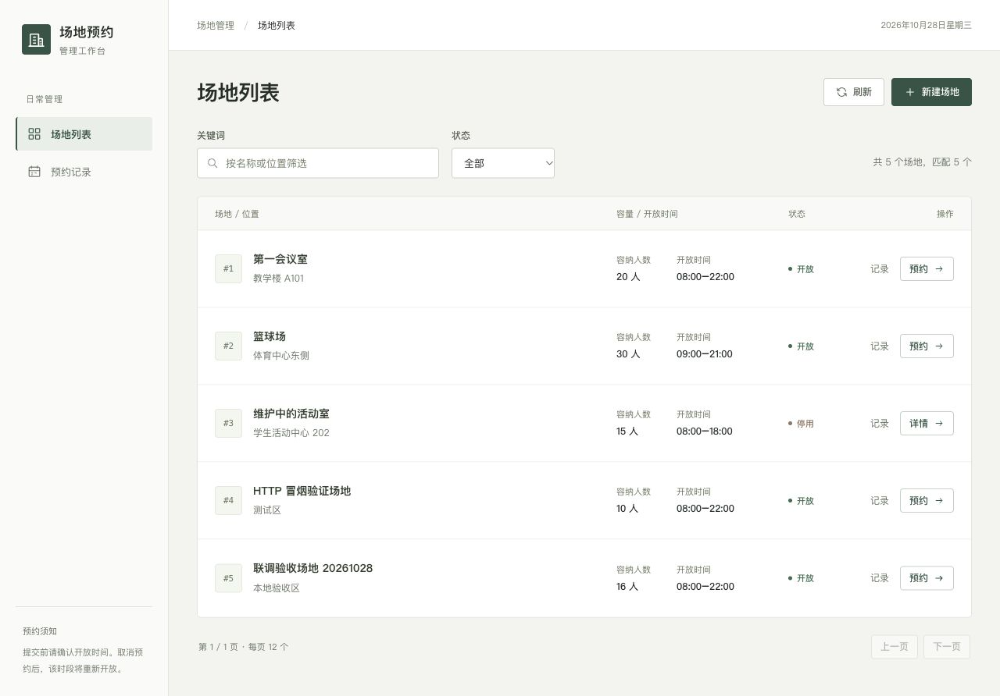
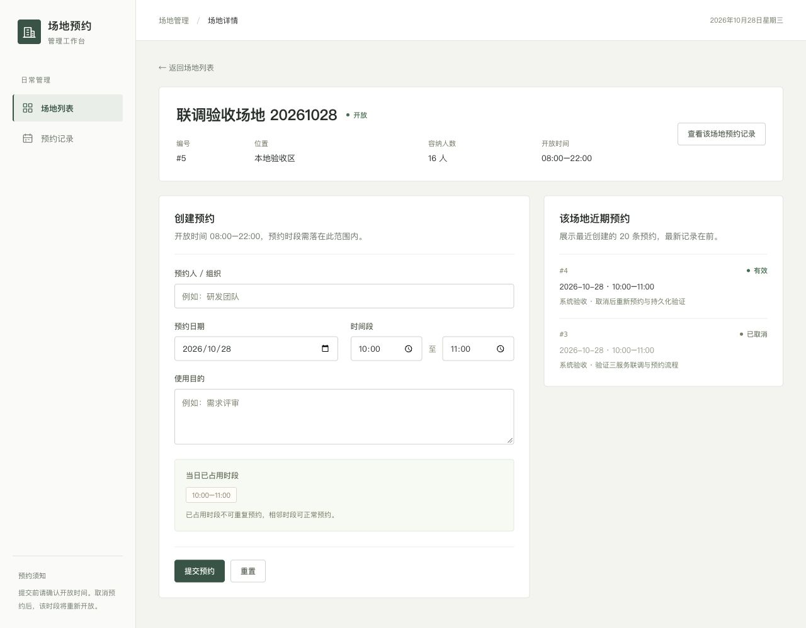
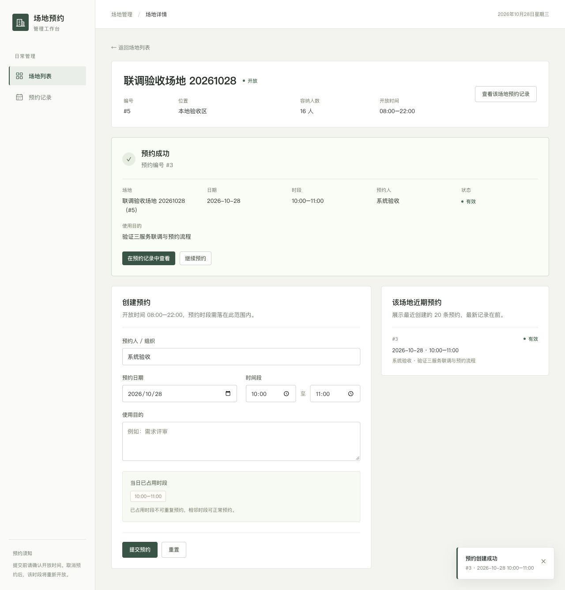
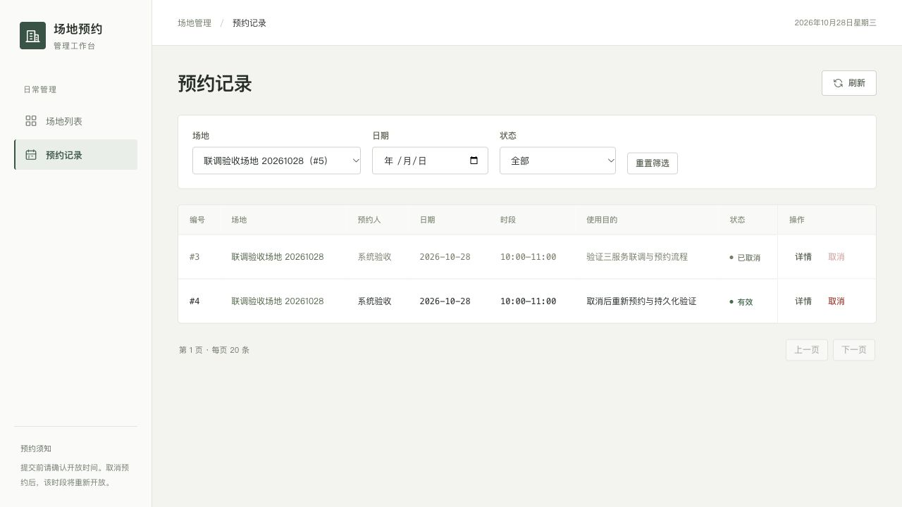
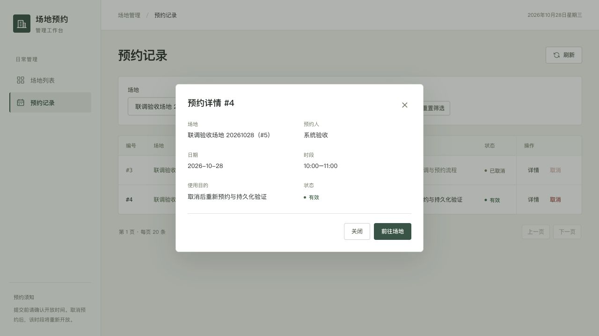
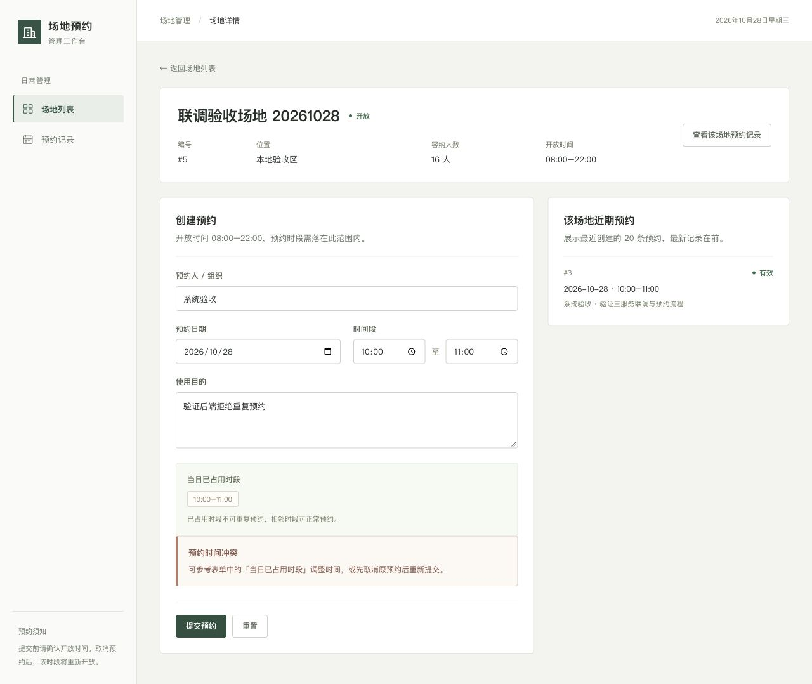

# 前端实现说明

前端负责场地浏览、预约操作和结果反馈，通过 HTTP 调用后端 API。完整架构、数据库、部署与分工见 [Lab 1 实验报告](../../docs/lab1-report.md)，容器配置见 [部署约定](integration-notes.md)。

## 技术与结构

使用 React 19、TypeScript、React Router 7 和 Vite 8。界面样式使用项目内 CSS，图标使用 SVG 组件。构建产物为静态文件，由 Nginx 1.29 托管。

| 位置 | 职责 |
|---|---|
| `src/pages/` | 场地列表、场地详情、预约记录和未找到页面 |
| `src/components/BookingForm.tsx` | 预约输入、字段校验和提交反馈 |
| `src/api/client.ts` | HTTP 请求、参数序列化、错误解析 |
| `src/api/types.ts` | 请求与响应类型，与后端字段对应 |
| `src/config.ts` | 运行时配置、构建期配置和默认代理路径 |
| `src/styles.css` | 页面布局、组件样式和响应式规则 |
| `nginx/`、`docker/` | 静态资源代理、路由回退及启动配置 |

页面持有各自的数据和交互状态，没有引入全局状态库。所有接口通过 `api.*` 调用，业务状态以服务端响应为准。

## 场地列表

接口按每批 200 条加载全部场地，再在浏览器内按名称、位置和状态筛选，每页显示 12 个。新建场地表单校验名称、位置、正整数容量以及完整、递增的开放时间，成功后刷新列表。后续请求返回后，早先未完成的列表请求不能覆盖新结果。

桌面使用侧栏导航和目录行布局；窄窗口使用顶部导航，场地信息分行显示。状态同时使用文字和圆点表示。

## 场地详情与预约

`/venues/:id` 查询场地信息，展示位置、容量、开放时间和状态。切换场地时重新建立页面状态，加载完成前不保留旧场地的预约表单。

表单提交 `venueId`、`organizer`、`reservationDate`、`startTime`、`endTime` 和 `purpose`。前端做必填和时间先后检查，开放状态、开放时间及重叠预约由后端再次校验。

当日占用时段按日期加载。切换日期后，旧请求晚到的结果会被忽略；加载中、加载失败和没有预约分别显示，避免把请求失败误认为时段空闲。近期预约由后端按编号降序返回最近创建的 20 条记录，失败时提供重试入口。

提交成功显示预约编号和完整信息，并刷新当前所选日期的占用时段与近期预约。再次提交前清除旧成功提示，避免与本次失败信息混淆。

## 预约记录与取消

`/reservations` 支持场地、日期和状态筛选。场地筛选直接读取 URL 的 `venueId`，链接跳转及浏览器前进、后退会同步更新筛选。每页展示 20 条，接口多取 1 条判断是否有下一页；恰好 20 条时不会继续进入空页。即使后续页的数据被取消或移除，仍保留返回上一页的入口。

点击详情查询单条预约并打开弹窗；快速查看不同预约时，只展示最后一次请求的结果。取消使用浏览器确认框，确认后调用显式取消接口。记录保留为已取消，取消按钮禁用；后续可创建同一时间段的新预约。

## 错误与反馈

| 场景 | 反馈 |
|---|---|
| 预约冲突 | “预约时间冲突”，提示参考占用时段调整或先取消原预约 |
| 参数错误 | “请检查填写内容”，字段错误显示到对应输入框 |
| 不存在的资源 | “未找到相关记录” |
| 数据库或服务故障 | 通用服务提示，不显示 SQL、异常堆栈或连接信息 |
| 时段或近期记录加载失败 | 显示加载失败和重试入口，不展示为空数据 |

## 构建与配置

Dockerfile 的构建阶段安装固定版本 pnpm，使用 lockfile 安装依赖并构建；运行阶段只复制静态产物与 Nginx 配置，不包含 Node 和源码。Nginx 主进程使用官方镜像默认用户，worker 使用 `nginx` 用户。容器监听 80，并通过 `/healthz` 提供健康检查。

API 地址按运行时 `config.js`、构建期 `VITE_API_BASE_URL`、默认 `/api` 的顺序解析。根目录 Compose 使用 `/api`，经 `frontend_net` 转发到 `api:8080`。即使同源代理，POST 的 Origin 仍需符合后端白名单。

修改 Compose 环境变量后重新创建前端容器，无需重新构建镜像。启动脚本会拒绝破坏 JavaScript 配置格式的 URL 字符。

## 测试与边界

`pnpm test` 覆盖完整场地加载、筛选分页、预约分页边界、异步请求顺序、场地切换、URL 筛选与错误反馈。`pnpm build` 同时执行类型检查和生产构建。

当前没有登录、权限和改期功能；前端时间输入精确到分钟。场地全量加载适合当前规模，数据增加后应由后端提供搜索与总数统计。占用时段仅作参考，是否允许提交始终由后端事务决定。
