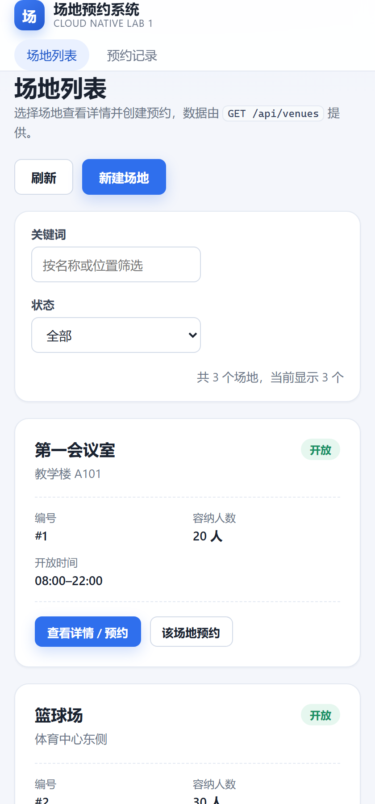

# 实验报告 · 前端章节

本文记录前端实现和初始验证结果。后端接口与数据库结构见 [backend/README.md](../../backend/README.md)；前端容器的运行约定见[部署对接说明](integration-notes.md)（三服务编排由部署维护方负责，不属于前端交付物）。

## 1. 分工与前端职责范围

小组按“前端与交互 / 后端与业务 / 数据库与部署集成”三部分分工，前端部分**只交付 `frontend/` 目录**：

| 交付物 | 位置 |
|---|---|
| 前端应用源码（页面、接口调用、交互与样式） | `frontend/src/` |
| 前端 Dockerfile 与 Nginx 配置 | `frontend/Dockerfile`、`frontend/nginx/`、`frontend/docker/` |
| 前端构建与运行说明 | `frontend/README.md` |
| 前端容器的运行约定（变量、端口、网络、CORS） | `frontend/docs/integration-notes.md` |
| 界面验收记录 | 本文的第 7 节与 `frontend/docs/screenshots/` |

`compose.yaml`、数据库、api 镜像、Volume 与端口策略由部署维护方负责；前端只在本地临时编排中验证过整条链路，验证用的编排文件不随提交。

分工边界：前端不实现预约冲突的最终判定，也不接触数据库；场地与预约的所有状态以 API 返回为准。

## 2. 技术选型

| 项 | 选择 | 理由 |
|---|---|---|
| 框架 | React 19 + TypeScript | 组件化拆分页面状态，类型约束接口字段，避免 camelCase 字段拼写错误 |
| 构建工具 | Vite 8 | 开发服务器自带代理，构建产物为纯静态文件，便于 Nginx 托管 |
| 路由 | React Router 7（BrowserRouter） | 场地详情使用 `/venues/:id` 独立地址，可刷新、可直接分享 |
| 样式 | 手写 CSS 变量 + 少量媒体查询 | 作业不要求复杂 UI，不引入 UI 组件库可减小镜像与依赖体积 |
| HTTP | 原生 `fetch` + 自封装 `ApiError` | 无额外依赖，错误码与 HTTP 状态直接暴露给界面分支 |
| 运行容器 | Nginx 1.29 alpine | 托管静态文件、反向代理 `/api`、提供健康检查端点 |

前端没有引入全局状态库：`venues`、预约列表、筛选条件都由页面组件持有，接口调用在 `useEffect` / 事件回调中完成，足以覆盖本实验的交互复杂度。

## 3. 前端结构

```text
src/
├── api/client.ts      # fetch 封装、URL 拼接、ApiError、错误码 → 文案
├── api/types.ts       # Venue / Reservation / 入参与查询参数类型
├── components/        # Layout、BookingForm、Badge、Feedback、ToastProvider
├── pages/             # VenuesPage、VenueDetailPage、ReservationsPage、NotFoundPage
├── lib/format.ts      # HH:mm:ss → HH:mm、本地日期、状态文案
├── config.ts          # 后端地址解析（运行时 → 构建期 → 同源）
└── styles.css         # 全部样式
```

请求分层：页面只调用 `api.*`，不直接写 `fetch`；`api/client.ts` 统一处理 URL 拼接、JSON 序列化、错误解析。后端错误体 `{"error":{"code","message","details"}}` 被转换成 `ApiError(status, code, message, details)`，界面据此分支，不做字符串匹配。

## 4. 页面与交互流程

### 4.1 场地列表 `/`

- 调用 `GET /api/venues`，以卡片网格展示名称、位置、容纳人数、开放时间与状态徽标；停用场地显示“停用”。
- 关键词与状态筛选在浏览器内完成（后端没有搜索参数），接口按每批 200 条完整加载场地；页面显示总数和匹配数，每页展示 12 个。
- “新建场地”折叠表单调用 `POST /api/venues`，成功后提示并刷新列表。

### 4.2 场地详情与创建预约 `/venues/:id`

- `GET /api/venues/{id}` 加载场地信息；编号无效或不存在时显示错误并支持重试。
- 表单字段：预约人/组织、预约日期、开始时间、结束时间、使用目的，与 `POST /api/reservations` 一一对应。
- 前端只校验必填项与“结束时间晚于开始时间”，不判断时段是否与已有预约重叠。
- 表单下方展示 `GET /api/reservations?venueId&date&status=ACTIVE` 得到的“当日已占用时段”，供用户选择未占用时段；时段标签仅用于展示。
- 提交成功后显示“预约成功”卡片（编号、场地、日期、时段、预约人、状态、使用目的）并刷新时段与近期预约。
- 提交失败时在表单内显示错误条，使用操作提示和字段校验信息，并滚动到可见位置；409 时自动重新拉取当日时段。

近期预约使用 `order=DESC&limit=20`，由数据库先按编号降序排序，再返回最新创建的 20 条记录。

### 4.3 预约记录 `/reservations`

- 调用 `GET /api/reservations`，支持 `venueId`、`date`、`status` 三个筛选条件与 `limit`/`offset` 分页（每页 20 条）。
- 场地列通过 `GET /api/venues` 的结果映射 `venueId → 名称`，因为列表接口不内嵌场地名称。
- “详情”按钮调用 `GET /api/reservations/{id}` 打开弹窗；“取消”按钮二次确认后调用 `POST /api/reservations/{id}/cancel`，成功后提示并刷新列表，已取消记录禁用取消按钮。
- 从场地详情跳转时带 `?venueId=`，实现按场地预筛选。

### 4.4 失败信息

| 场景 | 界面表现 |
|---|---|
| 时段冲突（409） | 红色错误条“预约时间冲突”，并刷新占用时段 |
| 参数错误（400） | 红色错误条“请检查填写内容”，`details[]` 中的字段错误标红到对应输入框 |
| 资源不存在（404） | “未找到相关记录”，提示刷新列表 |
| 数据库不可用（503） | “服务暂时不可用”，提示稍后重试 |
| 其他服务端错误（500） | “操作未完成”，提示稍后重试 |
| 网络不可达 | “暂时无法连接服务”，提示检查网络后重试 |

## 5. 配置外部化

后端地址按以下顺序解析；排查时检查浏览器网络请求和 `/config.js`：

1. 运行时配置 `window.__APP_CONFIG__.apiBaseUrl`：容器启动脚本根据环境变量 `API_BASE_URL` 生成 `config.js`；
2. 构建期变量 `VITE_API_BASE_URL`：`pnpm build` 时注入；
3. 默认值 `/api`：同源相对路径，由 Nginx 反向代理到 `api:8080`。

这样做的效果：容器部署默认同源代理，浏览器不产生跨域请求；需要直连其他后端时只改环境变量并重启容器，不必重新构建镜像；本地开发由 Vite 代理 `/api`，同样不依赖 CORS。

## 6. 前端 Dockerfile 与部署对接

### 6.1 镜像构建

| 作业要求 | 实现 |
|---|---|
| 可以独立构建前端镜像 | `docker build -t cloud-native-lab1-frontend:1.0.0 ./frontend` |
| 构建产物能够通过容器提供服务 | 构建阶段 `pnpm build` 产出 `dist/`，运行阶段由 Nginx 托管 |
| 不把本地依赖缓存和无关文件复制到镜像 | 多阶段构建，运行镜像只含 `dist` 与配置；`node_modules`、`dist`、`.env`、文档被 `.dockerignore` 排除 |
| 合理使用 `.dockerignore` | 见 `frontend/.dockerignore` |
| 明确容器监听端口 | `EXPOSE 80`；宿主机端口由编排映射（建议 `127.0.0.1:5173:80`） |

运行阶段细节：

- 固定 `pnpm@11.28.5` 并使用 `--frozen-lockfile`，保证依赖可复现；
- 不使用 root 运行 Node（Node 只出现在构建阶段），运行阶段仅 Nginx；
- `HEALTHCHECK` 访问 `/healthz`，编排可用 `service_healthy` 控制对外可用时机；
- 启动脚本 `40-runtime-config.sh` 写 `config.js`，Nginx 模板经 `envsubst` 注入 `API_UPSTREAM`。

### 6.2 交给编排的运行约定

前端容器只暴露两个环境变量，其余都交给部署维护方决定（详见 [integration-notes.md](integration-notes.md)）：

| 约定 | 值 | 说明 |
|---|---|---|
| 使用前端镜像 | `cloud-native-lab1-frontend:1.0.0` | 由 `frontend/Dockerfile` 构建 |
| 对外发布访问端口 | 容器 `80`，宿主机建议 `127.0.0.1:5173` | 端口号由编排决定 |
| 能够访问 api | `API_UPSTREAM=api:8080`（同网络服务名） | Nginx 把 `/api/` 原样转发 |
| 前端使用的后端地址 | `API_BASE_URL=/api`（默认） | 需要跨域直连时才改绝对地址 |
| 不直接访问 database | 前端容器不接收任何 `DB_*` 变量 | 只与 api 通信 |
| 依赖顺序 | `depends_on: api: service_healthy` | api 就绪后再对外提供页面 |

网络要求：前端与 api 在同一网络即可，无需加入数据库网络；api 是否发布到宿主机由部署维护方决定，前端运行不依赖该端口。浏览器访问的实际 origin 必须出现在后端 `CORS_ALLOWED_ORIGINS` 中，这一点已写入对接说明。

## 7. 验证记录

### 7.1 静态检查与镜像构建

```bash
cd frontend
pnpm typecheck   # tsc --noEmit，通过
pnpm build       # 通过，产物 dist/（CSS 14 kB，JS 291 kB，gzip 后约 94 kB）
docker build -t cloud-native-lab1-frontend:1.0.0 .   # 用本目录作为上下文，约 62 MB
```

为了验证前端在真实后端下的行为，本地另外用一份**临时的**三服务编排启动了 api 与 database（该编排文件属于部署维护方的范围，验证完成后已删除，不随本次提交）。当时的 `docker ps` 状态：

```text
SERVICE    STATUS                    PORTS
api        Up (healthy)              127.0.0.1:8080->8080/tcp
database   Up (healthy)              5432/tcp
frontend   Up (healthy)              127.0.0.1:5173->80/tcp
```

镜像与容器事实：

| 检查项 | 结果 |
|---|---|
| 前端镜像大小 | 62.5 MB（`cloud-native-lab1-frontend:1.0.0`） |
| 后端镜像大小 | 318 MB（`cloud-native-lab1-api:1.0.0`） |
| 前端镜像内容 | `/usr/share/nginx/html` 下只有 `index.html`、`assets/`、`config.js`，无 `node_modules`、源码与构建缓存 |
| Nginx 版本 | 1.29.8，master 为 root，worker 以 `nginx` 用户运行 |
| 前端监听端口 | 容器 80，宿主机 `127.0.0.1:5173` |
| 健康检查 | `/healthz` 返回 200，Compose 状态 healthy |
| 静态路由回退 | `GET /venues/1` 返回 `200 text/html`（SPA 刷新可用） |
| `config.js` 缓存 | `Cache-Control: no-store, must-revalidate` |

### 7.2 验收流程（本地全链路）

验证方式：本地临时编排启动 nginx + api + postgres 后，用无头 Edge 通过 CDP 对 <http://127.0.0.1:5173> 做真实点击与输入，数据全部落在 PostgreSQL 中（无任何模拟服务）。以下为初始版本验证记录；截图中的接口路径和 HTTP 错误码已在 2026-10-26 的界面调整中移除。步骤与作业 8.1 对应；正式的三服务部署由部署维护方按 [integration-notes.md](integration-notes.md) 编排后复跑即可。

| 步骤 | 操作 | 结果 | 截图 |
|---|---|---|---|
| 1 | 打开前端页面 | 场地列表显示数据库中的 3 个种子场地（2 个开放、1 个停用） | [01](screenshots/01-venues.png) |
| 2 | 查询场地列表 / 详情 | 卡片与详情页数据来自 `GET /api/venues`、`GET /api/venues/1` | [02](screenshots/02-venue-detail.png) |
| 3 | 创建正常预约 | `POST /api/reservations` 返回 201，页面显示“预约成功 / 编号 #1”并刷新占用时段 | [03](screenshots/03-booking-created.png) |
| 4 | 查询刚创建的预约 | 预约记录页出现 #1；详情弹窗经 `GET /api/reservations/1` 加载 | [05](screenshots/05-reservations.png)、[06](screenshots/06-reservation-dialog.png) |
| 5 | 创建时间冲突的预约 | 后端返回 409 `RESERVATION_CONFLICT`，界面显示错误条并刷新当日时段，未产生新记录 | [04](screenshots/04-booking-conflict.png) |
| 6 | 取消预约 | `POST /api/reservations/1/cancel` 后状态变为“已取消”，记录保留 | [07](screenshots/07-reservation-cancelled.png) |
| 7 | 取消后重新预约同一时段 | 同一场地、同一时段可再次创建成功（#2），证明取消已释放时段 | [08](screenshots/08-rebook-after-cancel.png)、[09](screenshots/09-reservations-after-rebook.png) |

第 7 步之后预约表中同时存在 `#1 CANCELLED` 与 `#2 ACTIVE`，说明取消是逻辑取消而非物理删除，与后端设计一致。

补充：作业“四、前端要求”第 7 条要求显示参数错误，后端 400 的两种形态都已验证：

| 场景 | 界面表现 | 截图 |
|---|---|---|
| 字段级校验失败（预约人超过 100 字，后端返回 `details`） | 输入框标红，错误条列出 `organizer：个数必须在0和100之间` | [11](screenshots/11-server-validation.png) |
| 业务规则失败（时段超出开放时间，`details` 为空） | 错误条显示后端原文“预约时间必须在场地开放时间内” | [12](screenshots/12-opening-hours-error.png) |

接口错误响应的实际形态（curl 抽查，与前端 `ApiError` 解析逻辑一致）：

| 请求 | 结果 |
|---|---|
| `POST /api/reservations` 预约人为空 | 400 `INVALID_ARGUMENT`，`details=[{field:"organizer",message:"must not be blank"}]` |
| `POST /api/reservations` 时段 06:00–07:00 | 400 `INVALID_ARGUMENT`，`details=[]` |
| `POST /api/reservations` 停用场地 #3 | 400 `INVALID_ARGUMENT`，`details=[]` |
| `GET /api/venues/999` | 404 `NOT_FOUND` |
| `GET /api/unknown` | 404 `HTTP_ERROR` |

移动端（420 px 宽）布局检查：顶栏换行、卡片单列、表单单列，无横向滚动。



### 7.3 配置外部化验证

**运行时配置（不重新构建镜像）**：起一个临时容器，把 `API_BASE_URL` 与 `API_UPSTREAM` 指向宿主机端口：

```bash
docker run -d --rm --name cfg-test -p 127.0.0.1:5174:80 \
  -e API_BASE_URL=http://127.0.0.1:8080/api \
  -e API_UPSTREAM=host.docker.internal:8080 \
  cloud-native-lab1-frontend:1.0.0
curl http://127.0.0.1:5174/config.js
curl -o /dev/null -w '%{http_code}\n' http://127.0.0.1:5174/api/venues
```

结果为 `window.__APP_CONFIG__ = { apiBaseUrl: "http://127.0.0.1:8080/api" };`，且经该容器的 `/api` 仍返回 200，说明换后端地址只依赖环境变量。

数据持久化属于“数据库与部署集成”部分，本章节不展开；本地验证时确认过 `docker compose down` 后重新启动，预约记录与状态保持不变。

### 7.4 联调中发现并修复的问题

| 现象 | 原因 | 处理 |
|---|---|---|
| 场地列表能看到数据，但提交预约返回 403，且响应体为空 | 浏览器用 `127.0.0.1:5173` 打开，而 api 的 `CORS_ALLOWED_ORIGINS` 只包含 `http://localhost:5173`。GET 不带 `Origin` 所以列表正常，POST 带 `Origin` 被 Spring CORS 拒绝 | 前端侧：对 403 给出专门提示；部署侧：把实际 origin 写进白名单，要求已写入 [integration-notes.md](integration-notes.md) |
| 前端只显示“请求失败（HTTP 403）”，难以定位 | 403 是 CORS 拒绝，不带 JSON 错误体 | 前端为 403 增加专门提示，直接给出当前页面 origin 与 `CORS_ALLOWED_ORIGINS` 的处理建议 |

### 7.5 已知限制

| 项 | 说明 |
|---|---|
| 登录与改期 | 后端没有鉴权与改期接口，前端也没有用户体系 |
| 分页 | 后端不返回总条数，前端以“下一页是否可点”判断是否有更多数据 |
| 时间精度 | 前端输入精度为分钟，只提交 `HH:mm` |
| 冲突判定 | 完全由后端负责；前端展示的“当日已占用时段”仅为参考 |

## 8. 问题与处理（可选）

| 问题 | 处理 |
|---|---|
| 预约成功后错误地保留旧的“预约成功”卡片，与新一次失败提示并列，容易误读 | 提交开始时清除旧成功卡片（`onSubmitStart`），失败信息滚动到可见位置 |
| 409 错误条在长表单下方，视口外不可见 | 失败时 `scrollIntoView({ block: 'center' })` |
| 详情页场地信息在窄容器中竖排 | 信息网格父级设置 `flex: 1 1 520px` 与 `width: 100%` |
| 移动端顶栏导航被品牌区挤压而溢出 | 720 px 以下导航独占一行 |
| 需要在不重新构建镜像的前提下更换后端地址 | 运行时 `config.js` + 容器环境变量 `API_BASE_URL` |
| 本机无法访问 Docker Hub，基础镜像拉取失败 | 通过可用的镜像加速源拉取后 `docker tag` 成官方名称，Dockerfile 与编排保持引用官方镜像 |
| `# syntax=docker/dockerfile:1` 让构建在离线/受限网络下直接失败 | 删除该指令；Dockerfile 只用到内置 frontend 支持的语法 |
| 浏览器 origin 与 CORS 白名单不一致导致 POST 403 | 前端对 403 给出可操作提示；白名单要求写进部署对接说明（需部署维护方落实） |
